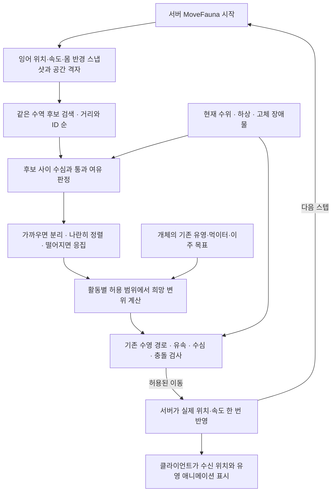

# 잉어의 떼 유영

2026-11-23 개발 명세 · 구현 전 · 기준 `codex/social-shelter-handoff` / `01047f42`. 같은 주의 독립 작업은 [지역 사슴 개체군의 플레이어 경험 명세](DEER_PLAYER_EXPERIENCE_SPEC_20261123.md)를 따른다.

## 플레이 목표와 적용 범위

넓은 물에서는 잉어가 주변 개체와 유영 속도와 방향을 맞추고 몸이 닿지 않는 간격을 유지한다. 좁은 통로에서는 대형이 늘어지며, 넓어지면 이웃을 따라 다시 모인다. 둑 양쪽이나 저수위로 단절된 두 웅덩이에서는 따로 움직인다. 첫 적용은 소유 맵의 CommonCarp 종 프로필이다. 떼는 매 스텝 형성되는 국소 이웃 관계다. 각 개체의 먹이·산란·이주 목표는 유지한다.

## 현재 코드와 연결점

| 현재 경로 | 다음 구현에서 맡을 일 |
|---|---|
| [Fauna 프로필](../../Source/AdaptiveEcosystem/Creature/Runtime/EcoFauna.h) | 기존 SwimDepthFraction, BodyRadius, WalkSpeed를 기준으로 단위를 맞춘다. 종별 opt-in과 이웃 거리·최대 수·회전 제한·세 조향 강도를 프로필에서 읽는다. |
| [MoveFauna](../../Source/AdaptiveEcosystem/Creature/Runtime/EcoFaunaMovement.cpp) | 기존 권위 이동 호출에서 개체별 이동 루프 직전에 살아 있는 참여 잉어의 스냅샷을 한 번 만든다. 이 함수의 수로 이주 승인·취소 경계는 유지한다. |
| [MoveFaunaInWater](../../Source/AdaptiveEcosystem/Creature/Runtime/EcoFaunaWaterMovement.cpp) | 기존 Goal과 접근·섭취 거리를 결정한 뒤, 조류를 더하기 전 희망 변위에 떼 조향을 반영한다. 기존 수중 검사, 속도/Transform 반영, 수중 사체의 별도 경로를 유지한다. |
| [수심과 수영 가능 공간](../../Source/AdaptiveEcosystem/Creature/Runtime/EcoCreatureMovement.cpp), [먹이와 산란장 판정](../../Source/AdaptiveEcosystem/Creature/Runtime/EcoFauna.cpp) | 종의 몸이 들어가는 물기둥, 중간 경로의 수심과 차폐, 실제 먹이터 도착·소비를 재사용한다. |

## 구조도

수중 검사는 두 곳에서 역할이 다르다. 이웃을 고를 때는 둑 건너의 잉어가 떼를 끌어당기는 것을 막고, 움직이기 직전에는 이번 스텝에 실제 몸이 통과할 수 있는지 확인한다. 앞의 판정으로 뒤의 충돌 검사를 생략하지 않는다.

## 스텝별 계약

1. **스냅샷.** 월드·지역·종·StableAgentId, 몸 중심(cm), 실제 속도(cm/s), 몸 반경(cm), 현재 활동을 복사한다. 초기 방향이 필요한 정지 개체에는 몸의 전방을 쓰고 정렬 평균에서는 정지 개체를 제외한다. 같은 시각의 모든 잉어가 같은 스냅샷을 읽는다. 사망·제거·지역 이탈은 다음 스텝에 제외한다. 임시 격자는 서버에서 재구성하므로 저장·복제 대상이 없다.
2. **이웃 검색.** 지역·종별 공간 격자에서 탐색 반경 안의 후보를 구한다. 제곱 거리, StableAgentId 순으로 정렬하고 검사 예산 이내에서 연결을 검증한다. 몸통 높이와 반경을 고려해 양 끝과 중간의 물기둥을 확인하고 고체 둑을 가로지르는 구간은 제외한다. 두 점 사이의 짧은 직선 수영 경로가 막히면 이번 스텝의 이웃에서 뺀다. 굽은 물길 전체의 경로 탐색은 기존 목적지·통로 선택이 맡는다. 수위 변경은 다음 이동 스텝부터 반영한다.
3. **세 조향 성분.** 분리는 중심 거리에서 두 몸 반경을 뺀 여유가 작을수록 강하게 적용한다. 중심이 겹친 두 개체에는 ID 쌍에서 재현 가능한 서로 반대 방향을 준다. 정렬은 움직이는 이웃의 평균 진행 방향·속도에 접근한다. 응집은 충분히 먼 이웃의 무게중심으로 약하게 기울인다. 이웃이 없거나 모든 성분이 0이면 기존 희망 변위를 그대로 쓴다.
4. **생태 행동과 결합.** 일상 유영은 기존 목표 방향에 세 성분을 혼합하고 종 속도·스텝 시간·최대 회전각으로 제한한다. 먹이터 접근은 기존 목표 방향 성분이 양수로 유지되는 범위에서 분리만 허용하고, 섭취 거리 안에서는 기존 정지/소비 처리를 우선한다. 명시적 통로 이주·산란 위치 유지·긴급 회피 중에는 기존 목적지와 제동을 우선하고 응집/정렬을 끈다. 이번 주 통로에서 자연스럽게 늘어나는 대형은 일상 유영 중의 좁은 수로에서 시연한다.
5. **적분과 실패.** 최종 후보는 기존 수영 속도 예산 안에서 만들고 기존 Water.Current를 한 번 더한다. 종의 선호 깊이, 수면/하상 여유, 스윕과 기존 단차 처리를 적용한다. 떼가 제안한 방향만 막혔다면 원래 목표의 변위를 같은 스텝에서 한 번 검증한다. 허용된 후보 하나만 반영하며 둘 다 막히면 기존 정체 처리로 돌아간다. 두 후보를 연달아 이동한 것으로 처리하지 않는다.

### 첫 시험 설정

아래는 소유 맵 **시험 시작값**이다. 종 프로필의 몸 반경을 `r`이라 하고, 서로 다른 체격의 분리 판정에는 두 개체의 실제 반경 합을 쓴다. 결과를 기록한 뒤 프로필 값을 고정한다.

| 항목 | 시작값과 의미 |
|---|---|
| 범위와 비용 | 이웃 탐색 반경 10r, 격자 셀 폭 10r, 가까운 후보 최대 16개 연결 검사, 유효 이웃 최대 6마리. 이웃 검사가 모든 생물의 전수 쌍 조회로 늘어나지 않게 한다. |
| 간격과 무리 폭 | 표면 간격 1r 이내에서 분리를 점증시키고 중심 거리 5r부터 응집을 적용한다. 몸이 맞닿을 때는 분리가 정렬·응집보다 우선한다. |
| 조향 강도와 회전 | 각 성분을 단위 방향과 [0,1] 세기로 환산한 뒤 분리 1.5, 정렬 1.0, 응집 0.4, 원래 목표 1.0으로 시작한다. 회전은 초당 90°부터 확인하고 실제 이동 속도는 종 프로필과 신체 상태의 한도를 따른다. |

## 구현 순서와 완료 시험

1. **11/23 기준선.** 소유 [수변 맵과 수위 기록](../Team/FAUNA_TEAM_HANDOFF.md)을 따라 `LV_JYU_RiparianReach`에서 실제 수심과 통로 폭을 측정한다. 넓은 물·병목·다시 넓어지는 구간의 위치와 시작 배치를 기록한다. 최소 시험군은 동일 크기의 잉어 8마리, 두 그룹의 단절 시험은 양쪽 4마리씩이다.
2. **11/25 조향.** 스냅샷·격자·후보 필터를 먼저 시험한 뒤 세 조향 성분과 기존 수영 경로를 연결한다. ID 순회 순서를 뒤집어 이웃 목록과 희망 변위가 같은지 확인한다.
3. **11/26 생태 회귀.** 수위가 변하는 동안 수역 이탈·유효 이웃·이동 거절 사유와 실제 먹이 소비를 관측한다. 제한된 수로에서 뭉치거나 제자리 회전을 반복하면 이웃 강도 조정 전에 연결 판정과 기존 목표 우선순위를 확인한다.
4. **11/27 통합.** 소유 섬 `LV_JYU_IslandEcosystemRefreshed`에서 시연한다. 소스 변경 후 직접 UBT Editor 빌드, 기존 [수생 자동화](../../Source/AdaptiveEcosystem/Creature/Runtime/EcoCreatureCombatTests.cpp)와 신규 조향 회귀, Standalone 및 Dedicated Server + Client 2명 결과를 남긴다.

| 시험 | 기록과 합격 기준 |
|---|---|
| 넓은 물에서 OFF/ON 비교 | 세 시드에서 같은 초기 배치·목표·수위·유속으로 각각 60 게임초를 기록한다. 처음 10초를 제외하고, 속력이 종 기준 속도의 10% 이상인 개체들의 단위 속도 벡터 평균 길이(0–1)를 스텝별로 계산한다. 유효 개체 2마리 이상인 구간과 표본 수를 남긴다. ON의 시간 평균이 세 시드 중 두 개 이상에서 OFF보다 높고 수역 이탈이 0건이면 통과한다. |
| 분리·병목·재집결 | 통제 시험에서는 양쪽 실행에 병목 건너편의 같은 일상 유영 목표를 준다. 매 스텝 최근접 이웃의 표면 간격(cm)과 음수인 연속 시간을 기록한다. 유효한 시작 배치에서 몸 겹침이 1게임초 이상 지속되는 쌍은 0이다. 열린 병목은 8마리 모두 통과하고, 마지막 개체가 나온 뒤 10게임초 이내에 6마리 이상이 하나의 이웃 연결 집합에 속하는 것을 초기 목표로 둔다. |
| 단절·수위 변경·단독 | 저수위에서 둑 건너 이웃 수와 마른 경로 통과 수는 0이다. 수위 상승 후 연속 수심과 몸 여유가 확보되고 두 그룹이 탐색 반경 안에 오면 다시 이웃을 찾는다. 단독 개체의 희망 변위는 같은 입력에서 기존 값과 같다. |
| 먹이·산란·네트워크 | 먹이터가 있는 고정 시험에서 잉어가 도달하고 서버 재고가 실제로 줄어든다. 기존 산란장·통로 이주 자동화를 재실행한다. 메기와 사체는 떼 후보 수 0, 클라이언트의 떼 계산과 위치 권위 쓰기 수 0을 확인한다. |
| 비용·재현성 | 8마리와 32마리에서 스텝당 후보 검사 수, 물기둥 질의 수, 조향 시간 중앙값/p95를 OFF/ON으로 남긴다. 후보/이웃 예산 상한을 검사하고 두 실행 순서에서 같은 스냅샷으로 같은 이웃을 고르는지 비교한다. |

이 문서의 시간·거리·수량은 다음 구현을 평가할 시험 조건이다. 실제 레벨에서 통과 가능한 폭과 시작 위치를 먼저 측정하고, 변경한 조건은 시드와 함께 결과에 기록한다.
