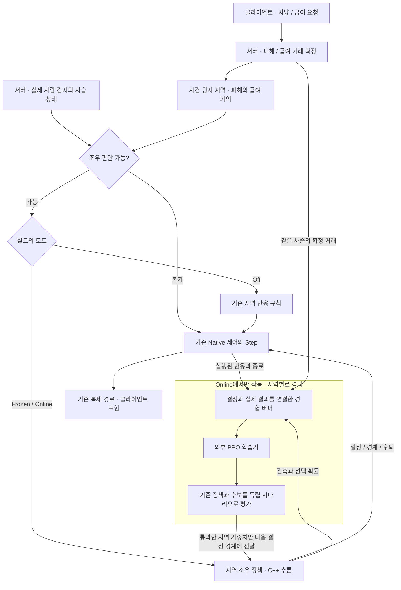

# 사슴의 플레이어 조우 정책과 선택형 온라인 학습 모듈

2026-11-25 · **개발 명세** · 기준 `jwj-1115` / `260ca50c` 작업 트리 · UE 5.8. 첫 구현의 설정, 수동 확인, 명세와의 차이는 [직접 확인 안내](DEER_ENCOUNTER_ONLINE_LEARNING_PLAYTEST.md)를 따른다.

**목표**는 사슴이 사람을 실제로 발견했을 때 일상을 계속할지, 멈춰 경계할지, 물러날지를 그 지역의 플레이 경험으로 배우는 것이다. 예를 들어 숲에서 사냥이 반복되면 그곳에서 직접 피해를 입지 않은 사슴도 낯선 방문객에게 일찍 물러나고, 급여가 반복된 초원에서는 접근을 더 가까이 허용할 수 있다. 학습 효과는 같은 지역 경험을 입력받는 고정 정책과 비교해 판정한다. [지역 경험 요구사항](DEER_PLAYER_EXPERIENCE_SPEC_20261123.md)

**확정 결과 기반 학습 후속 구현.** `Online`에서 같은 지역의 확정 피해 또는 급여 결과 6건으로 후보 생성을 시작한다. 실행된 조우 행동에 연결할 수 있는 결과는 아래 PPO 표본 계약을 따르고, 모든 확정 결과는 지역 출력층을 직접 갱신하는 보조 학습에 사용할 수 있다. 보조 학습 후보는 별도로 남긴 확정 결과에서 기준 조우의 후퇴 선호를 평가한다. 사슴이 선택한 행동이나 회피 효과를 가정하지 않는다. [현재 설정과 평가 기준](DEER_ENCOUNTER_ONLINE_LEARNING_PLAYTEST.md)

## 1. 어디까지 구현되어 있는가

| 현재 소스에서 확인한 동작 | 이번 모듈에 필요한 연결 |
|---|---|
| 플레이어 공격으로 실제 감소한 HP 비율, 급여로 실제 증가한 Energy 비율을 권위 지역에 기록한다. 급여 예약의 확정·반환은 Native 섭취 결과를 따른다. | 거래가 확정된 지점에서 대상 사슴과 결과를 열린 조우에 한 번 연결한다. 입력 버튼·목격·경보 횟수는 보상에 더하지 않는다. [피해 확정](../../Source/AdaptiveEcosystem/Creature/Runtime/EcoCreaturePlayerOutcomes.cpp) · [급여 확정](../../Source/AdaptiveEcosystem/Creature/Runtime/EcoDeerPlayerExperience.cpp) |
| 지역별 피해와 급여를 따로 감쇠·누적한다. 현재 조우 소비자는 두 값의 차인 `GetDeerPlayerAttitude`를 읽는다. 사건 순번은 집계 안에서 생성된다. | 같은 권위 시각에서 두 값을 읽는 스냅숏과 확정 결과 전달 지점을 추가한다. 기존 합계를 다시 차분하거나 로그를 파싱하면 대상을 복원할 수 없다. [지역 집계](../../Source/AdaptiveEcosystem/Ecology/EcologySimulationSubsystem.cpp) · [경험 자료형](../../Source/AdaptiveEcosystem/Core/EcoDeerPlayerExperience.h) |
| `ObservePlayers`가 시각 증거를 만들고, `IntegratedControlHook`의 `bUseRegionalResponse`와 `EvaluateRegionalEncounter`가 지역 반응을 결정한다. 기존 Native Step이 의도를 받아 이동·대사·섭식을 수행한다. | 지역 반응을 고르는 지점에 모드 선택을 한 번 둔다. 시야·최근 증거·안전·여행·예약 조건은 공통으로 적용한다. [실제 소비자](../../Source/AdaptiveEcosystem/AI/Policy/EcoPolicyV3IntegratedProcessors.cpp) · [Native Step](../../Source/AdaptiveEcosystem/AI/Policy/EcoWorldV3.h) |
| 기존 AutoAdapt는 환경 변화 스냅숏과 기존 v3 두뇌 후보를 주고받는다. | 검증 후 결정 경계에서 교체하는 절차를 참고한다. 조우 정책에는 독립된 계약 ID·버전·저장 경로를 부여한다. [기존 교체 계약 §5–6](../RL_Policy/LIVE_ADAPT_SPEC.md) |

## 2. 전체 구조

서버에는 두 가지 주기가 있다. **조우 결정 주기**에는 사슴별 관측으로 현재 정책을 한 번 평가하고 Native가 행동을 실행한다. **학습 주기**에는 같은 지역·정책 버전의 경험이 충분할 때 외부 작업자가 후보를 만든다. 작업자가 느려도 서버는 현재 정책으로 다음 결정을 내린다. 클라이언트의 영향은 권위 거래와 그 결과를 통해 전달된다. [Epic의 정책 평가와 RunInference](https://dev.epicgames.com/documentation/en-us/unreal-engine/API/Plugins/LearningAgents/ULearningAgentsPolicy?application_version=5.8) · [Epic 네트워킹 개요](https://dev.epicgames.com/documentation/en-us/unreal-engine/networking-overview-for-unreal-engine)

## 3. 모듈 소유권과 활성화

기존 `AdaptiveEcosystem` 런타임 모듈 안에 **월드 수명과 같은 선택형 기능 객체**를 둔다. 소유자는 통합 v3 권위 월드이고, 각 스포너는 담당 지역을 등록한다. 한 지역에는 한 소유자만 등록할 수 있다. 같은 프로세스의 여러 PIE 월드는 메모리·작업자·파일 경로를 분리한다. 기존 사슴 정책과 Mass Fragment는 학습기의 존재를 알 필요가 없다. Epic Learning Agents의 추론·경험 수집 API는 설계 참조로 사용한다. 첫 구현에 필요한 엔진 플러그인 의존성은 추가하지 않는다. [프로젝트 모듈 구성](../../AdaptiveEcosystem.uproject) · [Epic Learning Agents의 모듈 및 Experimental 상태](https://dev.epicgames.com/documentation/unreal-engine/API/PluginIndex/LearningAgents?application_version=5.8)

다음은 **제안하는 설정과 명령**이다. 소유 테스트 맵 스포너의 `AllowDeerEncounterLearning`은 기본 꺼짐이다. 허용된 개발용 Server/Standalone 월드에서 운영자가 월드를 지정한 콘솔 명령 `eco.DeerEncounter.Mode Off|Frozen|Online`으로 전환한다. 맵의 허용만으로 시작하지 않으며 매 세션은 Off로 시작한다. 클라이언트 RPC에 모드 변경 권한을 제공하지 않는다.

| 모드 | 조우 행동의 출처 | 모듈이 사용하는 자원 |
|---|---|---|
| **Off** (기본) | 기존 설정의 조우 경로. 기존 지역 경험이 켜져 있으면 종전 규칙이 계속 작동한다. | 모드 확인 외 신규 추론·버퍼·구독·작업자·파일 I/O 0 |
| **Frozen** (고정 추론) | 검증된 초기 조우 정책 또는 같은 세션에서 채택한 지역 가중치 | C++ 추론만 수행. Online과 동일한 행동 선택 방식과 전용 난수열을 써서 비교 가능하게 한다. |
| **Online** (추론과 학습) | Frozen과 같은 추론. 검증을 통과한 지역만 새 버전을 사용한다. | 확정 결과 구독, 용량 제한 경험 버퍼, 외부 개발용 학습기 및 후보 평가를 활성화한다. |

**시작.** 다음 결정 경계에서 테스트 맵 허용, 서버 권위, 스포너 준비 완료, v3·ecosystem life·기존 deer player experience 활성, 초기 모델 계약을 확인한다. 모드 요청은 월드별로 직렬화한다. 동일 모드 요청은 멱등이다. 실패하면 기존 모드와 이유를 반환한다. 새 기능이 기존 플래그를 자동으로 켜지 않는다. 학습 실험 중 기존 AutoAdapt나 세계 설정이 바뀌면 진행 중인 배치를 폐기하고 새 기준으로 시작한다.

**중지·재시작.** Online → Frozen은 다음 결정 경계에서 데이터 수집을 중지하고 마지막 채택 모델로 추론을 계속한다. Off는 기존 규칙으로 돌아가 모듈 구독·버퍼·메모리 모델을 해제한다. 두 전환 모두 실행 세대 번호를 올려 대기 중 후보를 무효화하고, 전용 작업자에 취소를 요청한 뒤 비동기로 회수한다. 이전 작업자 회수를 마치기 전에는 같은 세션에 새 작업자를 만들지 않는다. 월드 종료·PIE 종료·체크포인트 복원도 같은 정리 절차를 거친다. 복원은 Off, 재활성화는 지정한 초기 모델에서 시작한다. 지역 경험과 게임의 미결 급여는 기존 소유자의 수명주기를 따른다.

## 4. 조우 정책과 학습 표본

**RL 담당과 확정할 별도 실험 계약.** 첫 후보는 공통으로 사전 준비한 작은 신경망과 **지역별 행동 출력층**이다. 온라인 옵티마이저는 사건이 발생한 지역의 출력층만 갱신한다. 사슴은 현재 소속 지역의 같은 버전을 공유한다. 새끼와 이주가 확정된 사슴도 해당 지역 정책을 읽는다. 공통 신경망과 초기 가중치의 해시를 고정하고 V1·v3·R7e의 모델, mask, Raw Request, 기존 보상은 보존한다. [학습 담당 경계와 Golden 검증](../RL_Policy/ECOSYSTEM_RL_AGENT_GUIDE_20261024.md)

| 항목 | 첫 실험에서 합의할 계약 |
|---|---|
| 입력 순서 | ① 감지 거리 / 현재 유효 시야 반경 ② 접근 속도(cm/s, 접근이 양수) ③ 현재 Energy 비율 ④ 지역 피해 압력 ⑤ 지역 급여 친숙도. ①·③–⑤는 [0,1], ②는 기존 기준 900 cm/s로 나눈 뒤 [-1,1]로 제한하는 안이다. 유효 반경 0, 오래된 시각 증거, 비유한 입력은 기존 경로로 처리한다. |
| 행동 | 0 = 기존 일상 정책에 제어 반환, 1 = 기존 Vigilant, 2 = 기존 Retreat. 0은 섭식·정지를 강제하지 않는다. 결과는 기존 조향 의도에만 반영한다. 최근 피격·포식자·패닉·은신·여행·Social 예약이 제어를 맡으면 신규 결정을 만들지 않는다. |
| 결정 구간 | 권위 시뮬레이션의 고정 결정 시점에 입력을 캡처한다. 이미 열린 구간을 닫고 새 구간을 연다. 대상 사슴의 다음 결정 또는 조우 종료까지 실제 결과를 합산한다. 동일 시각의 거래는 서버 처리 순번으로 어느 구간에 속하는지 결정한다. |
| 보상 원자료 | 사슴이 실제 얻은 급여 Energy 비율과 플레이어에 의한 실제 HP 손실 비율을 각각 보관한다. 후보식은 `wFeed × 급여 비율 − wDamage × 피해 비율`이다. 무사 통과는 0이며 자연 섭식·늑대 피해·빗맞음·거절된 급여는 보상 0이다. 지역 누적치나 경보를 다시 보상으로 더하지 않는다. |
| 궤적과 종료 | 관측, 선택 행동, 선택 당시 로그확률·가치 추정치, 실제 반영 여부, 두 보상 성분, 다음 관측, 종료 사유, 정책 버전·계약 해시를 기록한다. 사망은 종결 상태다. 시간 제한에 의한 절단은 유효한 마지막 관측의 가치로 보정한다. 이전 시점에 유효한 결정이 없는 피해는 지역 통계에만 남긴다. |

**표본 연결과 익명성.** 서버 내부에서만 `WorldEpoch + RegionId + StableAgentId + 결정 순번`으로 열린 구간을 찾는다. 대상 사슴을 아는 거래 소유자가 발급하거나 재사용하는 확정 거래 키로 중복 전달을 제거한다. 기존 집계가 호출될 때마다 증가시키는 로그 순번만으로 원거래 재전송을 판별할 수 없다. 결과 발행 순서는 실제 피해·섭취 확정 → 열린 구간에 보상 반영 → 사망·직접 피격 등 우선 반응으로 구간 종료다. 실행 전 다른 규칙이 행동을 대체한 결정은 PPO 표본에서 제외한다. 실행된 뒤 중단됐다면 그때까지의 결과만 귀속한다. 이주·복원·모드 변경으로 권위나 버전이 바뀐 미완성 궤적은 폐기한다. 외부 학습기에는 임시 궤적 번호를 전달하고 플레이어·계정·Pawn·사슴의 영속 ID는 전달하지 않는다.

## 5. 학습·평가·교체 계약

1. **한 버전으로 수집한다.** PPO는 현재 정책이 선택한 행동의 경험을 사용하는 on-policy 방식이다. 지역마다 행동 정책 버전·계약·세계 설정이 같은 배치를 닫아 한 번만 제출한다. 최소 유효 결정 수와 독립 조우 수가 모두 충족돼야 한다. 특정 보상값이 나온 조우만 골라내지 않는다. 지역당 동시 후보는 하나이며 버퍼가 차면 새 궤적 수집을 건너뛰고 누락 수를 기록한다. [OpenAI PPO 알고리즘과 궤적 수집 절차](https://spinningup.openai.com/en/latest/algorithms/ppo.html)
2. **월드 밖에서 학습한다.** 서버는 완결된 불변 배치만 작업자에게 전달한다. 월드·Mass 포인터를 넘기지 않는다. 외부 Python 프로세스가 역전파와 평가를 수행하고 C++가 매 결정 추론을 수행한다. 배치·후보는 세션별 `Saved/DeerEncounterLearning/<session>/<region-key>/`에 임시 파일로 쓴 뒤 원자적으로 게시한다. 지역 경로에는 파일명으로 인코딩한 키를 쓴다. 기존 AutoAdapt 감시 폴더와 분리한다. Epic 역시 충분한 경험을 모은 뒤 학습과 정책 동기화를 수행한다. [Epic Process Experience](https://dev.epicgames.com/documentation/en-us/unreal-engine/BlueprintAPI/LearningAgents/ProcessExperience)
3. **후보를 독립적으로 비교한다.** 후보에는 세션·지역·실행 세대·부모 버전·계약 및 가중치 해시를 넣는다. 서버는 현재 부모와의 일치, 텐서 모양·유한값, Python/C++ Golden 관측의 출력 일치를 검사한다. 평가는 학습 배치 밖의 고정 시드와 동일한 사냥·급여·무관심 방문 시나리오에서 수행한다. 사냥 조건의 피해량과 급여 조건의 실제 획득 Energy를 각각 평가해 ‘모든 방문자에게 도주’하는 후보도 걸러낸다.
4. **결정 경계에서 교체한다.** 합격한 지역 후보만 다음 경계에서 불변 가중치 포인터로 교체한다. 한 결정 묶음의 모든 사슴은 같은 지역 버전을 본다. 이전 버전의 열린 표본은 새 PPO 배치와 섞지 않는다. 오류·시간 초과·부분 파일·만료된 결과는 현재 정책을 유지하고 사유를 기록한다. 작업자 실패 시 Frozen으로 내려가며, 직전 승인 버전으로 되돌릴 때에도 실행 세대를 올린다. [Google의 지속 학습·모니터링·롤백 설명](https://developers.google.com/machine-learning/crash-course/production-ml-systems/static-vs-dynamic-training)

첫 실험 전에 RL 담당자가 결정 간격, 초기 모델·정규화, 보상 계수, PPO 설정, 최소 표본 수, 고정 평가 시드, 허용 성능 저하 및 메모리·스텝 시간 예산을 실험 설정에 기록한다. 기존 R9 판정 시드는 사용하지 않는다. **사냥 또는 급여 한 종류의 평가 표본으로도 학습할 수 있다.** 후보는 관측된 지표 중 하나에서 합의 기준만큼 개선되고 권위·안전·자원 보존 검사를 통과해야 한다. 둘 다 관측되면 다른 지표의 변화도 허용 범위에 있어야 한다. 관측하지 못한 지표는 미평가로 기록한다. 표본이 부족하면 현재 정책으로 플레이를 계속한다.

## 6. 구현 순서와 완료 판정

| 단계 | 개발 작업 | 통과 조건 |
|---|---|---|
| 1. 기준 고정 | 소유 복사 맵의 두 지역에서 기존 규칙으로 피해·급여·무사 통과를 재현한다. Off 상태로 같은 시드·입력 재생을 비교한다. | 추가 작업자·구독·버퍼·파일 생성 0. 기존 행동·자원 결과와 일치. [직접 실행 가이드](DEER_PLAYER_EXPERIENCE_SETTINGS_20261123.md) |
| 2. 고정 추론 | 초기 모델과 동일 관측 Golden을 준비하고 Frozen에서 C++ 추론을 연결한다. | 같은 입력에서 Python/C++ 행동 확률이 합의 오차 이내. 직접 피격·늑대 도주·이주·은신 우선순위 보존. 최초 경계 거리와 실제 변위를 함께 기록. |
| 3. 온라인 갱신 | 확정 거래·결정 연결, 제한 버퍼, 외부 학습, 평가, 지역별 교체를 연결한다. | 승인된 버전에서 고정 관측의 행동 확률이 실제 변하고, 독립 시나리오 성과가 채택 기준을 통과. 조용한 조우도 표본에 포함. 중복 거래·포만 거절의 추가 보상 0. |
| 4. 지역·네트워크 | 동일 시드의 Off/Frozen/Online에서 조우 전 상태를 맞춘다. 숲·초원에서 사냥·급여 역할을 바꿔 재실행한다. 급성 경보 후 미경험 사슴에게 낯선 방문객이 동일 경로로 접근한다. | 최초 경계·후퇴 거리, 피해율, 급여 획득량을 모드별로 비교. A 지역 학습 후 B의 모델 해시·고정 입력 확률 동일. Dedicated Server + Client 2명에서 서버만 결정·집계·학습하고 클라이언트 학습 작업자 0. |
| 5. 해제·장애 | Online → Frozen → Off, 재활성화, 작업자 지연·종료, 이전 후보 재도착, 손상 파일, 복원·PIE 재시작을 재현한다. | 늦은 후보 적용 0, 비동기 정리 후 남은 작업자 0. 동기 대기로 인한 게임 스텝 정지 0. 활성 시 피크 메모리와 p95 스텝 시간이 사전 예산 이내. |

개발 로그는 모드·지역·현재/부모 버전·세대, 유효 결정/조우 수, 실제 두 보상 성분, 제외·누락 사유, 후보 판정·롤백, 스텝 비용을 남긴다. 같은 기록으로 지역 기억 변화와 가중치 변화의 효과를 따로 비교할 수 있어야 한다. C++ 구현 후에는 저장소 규칙에 따라 직접 UBT Editor 빌드, 관련 자동화, 소유 맵 Standalone과 Dedicated Server + Client 2명 검증을 실행한다. 이 문서의 통과 조건은 후속 개발의 완료 기준이다.
