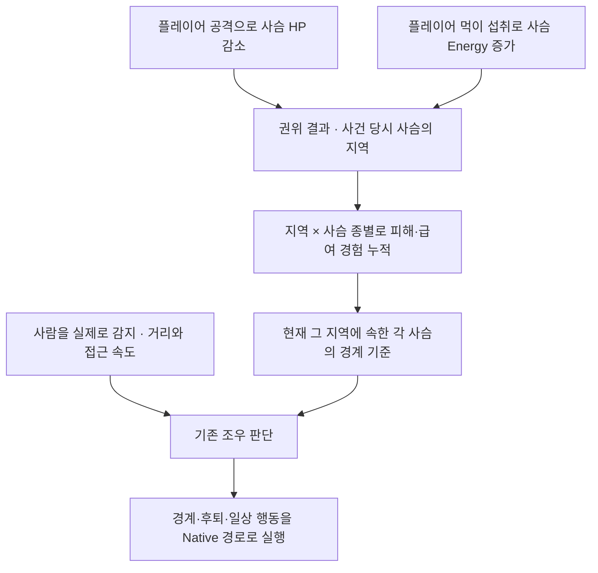

# 지역 사슴 개체군의 플레이어 경험 학습

2026-11-23 사용자 결정 · 구현 전 개발 명세 · 기준 `codex/social-shelter-handoff` / `01047f42`. 같은 주의 [잉어 떼 유영 명세](CARP_SCHOOLING_SPEC_20261123.md).

2026-11-25 후속 개발은 [선택형 사슴 조우 온라인 학습 모듈 명세](DEER_ENCOUNTER_ONLINE_LEARNING_SPEC_20261125.md)를 따른다. 기존 지역 경험 규칙을 기준으로 고정 신경망과 플레이 중 갱신한 신경망을 비교하는 설계다.

## 설계 결정

**학습 단위는 지역에 속한 사슴 개체군이며, 학습 대상은 사람 일반에 대한 행동 양식이다.** 숲에서 여러 플레이어의 공격으로 사슴들이 피해를 입으면 숲 사슴들은 처음 보는 방문객에게도 일찍 경계한다. 초원에서 먹이를 받아 실제 Energy를 얻는 일이 반복되면 초원 사슴들은 같은 방문객의 접근을 더 가까이 허용한다. 직접 사건을 겪지 않은 사슴에게도 지역 성향이 적용된다.

경험 상태의 키는 서버의 `RegionId`와 종(`SpeciesId`, 이번에는 사슴)이다. 학습 데이터와 의사결정에는 클라이언트·계정·PlayerState·Pawn 식별자 및 사슴과 사람 사이의 관계 테이블을 두지 않는다. 대상 사슴과 입력 소유자 확인은 실제 피해·급여 거래의 검증 범위에서만 이루어진다.

지역 공유와 익명성은 확정 요구사항이다. 이번 주 구현안은 서버가 익명 결과를 누적하고 감쇠시키는 규칙 기반 적응이다. 런타임 신경망 업데이트 여부는 별도 학습 방식 결정이며, 어느 방식을 택하든 지역 단위와 익명성은 같다.

## 구조도

지역 성향은 사람과 마주쳤을 때 쓸 기준이다. 멀리 있는 개체가 사건 위치로 일제히 도망치거나 플레이어 위치를 새로 알게 되는 신호는 기존 감각·경보 경로에서만 발생한다.

## 연결 지점과 처리 계약

| 단계 | 구현 계약 |
|---|---|
| 피해 확정 | [ApplyPlayerDamage](../../Source/AdaptiveEcosystem/Creature/Runtime/EcoCreaturePlayerOutcomes.cpp)에서 플레이어가 가한 실제 양의 HP 손실을 결과로 발행한다. 사건 당시 피해 사슴의 권위 지역에 1회 귀속한다. 은폐된 공격도 서버가 확인한 생태 압력으로 집계한다. 직접 피격·공격자를 보았는지·주변 목격·무리 경보는 기존 즉시 반응을 따른다. 목격과 전파는 추가 피해 건수로 세지 않는다. |
| 급여 확정 | [플레이어 입력](../../Source/AdaptiveEcosystem/Creature/Player/EcoPlayerEcologyComponent.h)에서 서버가 대상·거리·재고를 검사하고 유한한 먹이를 예약한다. [Native 섭취 단계](../../Source/AdaptiveEcosystem/AI/Policy/EcoWorldV3.h)에서 기존 자연 섭식·비축을 포함한 같은 조건으로 급여가 더한 Energy를 산출한다. 실제 소비와 양의 기여분을 같은 권위 처리 경계에서 확정한다. 포만·사망·거리 이탈·재고 부족·요청 만료는 예약을 반환한다. 식생 소비와 플레이어 재고는 각각의 공급원에 정산한다. |
| 익명 집계 | 월드 epoch, 서버가 부여한 고유 사건 ID, RegionId, SpeciesId, 시뮬레이션 시각, 사건 종류, 실제 손실 HP 비율 또는 급여 기여 Energy 비율을 사용한다. 집계는 결과당 한 번이며 요청 재전송·목격자 수·클라이언트 수로 증가하지 않는다. 연결 정보는 거래 검증 단계에서 끝낸다. |
| 지역 상태 | 피해 압력과 급여 친숙도를 [0,1]로 유지한다. 게임 시간으로 감쇠한 뒤 확정 결과의 크기에 비례해 가산하고 상한을 적용한다. 행동 스텝의 모든 사슴은 동일한 지역 스냅샷을 읽는다. 중립에서 시작하고 타 지역으로 직접 전파하지 않는다. 출생한 사슴과 이주가 확정된 사슴도 현재 소속 지역 값을 읽는다. |
| 기존 지역 위험과의 관계 | [기존 지역 위험 자료형](../../Source/AdaptiveEcosystem/AI/Policy/EcoLifeHistoryV3.h)과 [이주 소비자](../../Source/AdaptiveEcosystem/Mass/EcoHerdMigration.cpp)를 확인한다. 현재 KnownHumanDanger는 인지된 사냥 사건을 집계하며 [체크포인트](../../Source/AdaptiveEcosystem/Creature/Runtime/EcoEcosystemCheckpoint.cpp)에 저장된다. 새 적응은 익명 피해·급여 두 결과를 권위 지역에 쌓는다. 기존 이주 위험에 급여나 동일 피해를 다시 더하지 않는다. 첫 구현 제안은 세션 범위이며 월드 시작·체크포인트 복원에서 새 성향과 미결 거래를 함께 초기화한다. |
| 행동 소비 | [ObservePlayers와 IntegratedControlHook](../../Source/AdaptiveEcosystem/AI/Policy/EcoPolicyV3IntegratedProcessors.cpp)에서 살아 있고 깨어 있는 사슴이 실제 사람을 감지했을 때 현재 지역의 경계/후퇴 거리를 사용한다. 여러 사람이 보이면 현재 감각 증거로 방향을 고른다. 직접 피격, 늑대, 패닉, 은신, 이동 예약의 기존 우선순위를 지킨다. 클라이언트는 실행된 위치·활동을 표시한다. |

## 구현 순서

1. 소유 테스트 맵의 두 지역에 동일한 시드·중립 개체·관측 조건을 준비한다. 시야·접근 속도·배고픔을 통제하고 기본 최초 경계 거리(cm)를 기록한다.
2. 권위 결과를 익명화해 지역별로 누적한다. 서버 진단에는 지역·종·확정 사건 수·피해/급여량·성향 전후를 남긴다. 실플레이에서 급여 수락과 실패, 중복 정산을 확인한다.
3. 첫 튜닝은 `지역 성향 = 피해 압력 − 급여 친숙도`로 계산한다. 중립 거리에서 성향이 높아질수록 경계 거리가 늘어나고 낮아질수록 줄어들도록 감지 반경 안에서 제한한다. 진입/해제 거리를 분리한다. 감쇠·계수는 소유 맵 시드 비교로 정한다. 기존 이동 관찰에 지역 성향과 실제 최초 경계·후퇴 거리를 남긴다. [이동 관찰 가이드](../Performance/MassMovement/10_MOVE_TEST_OBSERVE_GUIDE.md)
4. 기존 v3 정책과 Native 단일 이동·대사 경로를 유지하며 소유 맵에서만 기능을 켠다. 코드 변경 후 직접 UBT Editor 빌드, 관련 자동화, Standalone과 Dedicated Server + Client 2명으로 확인한다.

## 합격 기준

| 시험 | 관측할 결과 |
|---|---|
| 낯선 방문객과 미경험 사슴 | 숲에서 일부 사슴에게 반복 피해, 초원에서 일부 사슴에게 반복 급여를 확정한다. 급성 경보가 끝난 뒤 양 지역에서 사건을 직접 겪지 않은 사슴에게 같은 새 플레이어가 같은 경로로 접근한다. 숲 사슴의 최초 경계 거리가 초원보다 길다. 지역별 사건을 바꾼 독립 실행에서는 결과도 뒤집힌다. |
| 클라이언트 교체 | 동일한 지역 스냅샷과 감각·개체 상태에서 기존 공격자, 급여자, 신규 접속자가 같은 움직임을 재현하면 같은 경계 판단을 낸다. 새 접속이나 부활 자체로 지역 성향이 변하지 않는다. |
| 지역 격리와 이주 | 사건이 집계된 지역의 사슴 성향만 변한다. 다른 지역에서 온 사슴은 소속 변경이 확정된 뒤 도착 지역 성향을 사용한다. 사람을 감지하지 않은 사슴에게 지역 갱신만으로 후퇴 명령이 생기지 않는다. |
| 원인과 보존 | 빗맞음, 자연 섭식, 포만으로 거절된 먹이, 늑대 피해는 플레이어 경험 증가 0건이다. 재전송은 원거래와 합쳐 1건이다. 급여 지역에서도 직접 피격·포식자 도주는 유지한다. |
