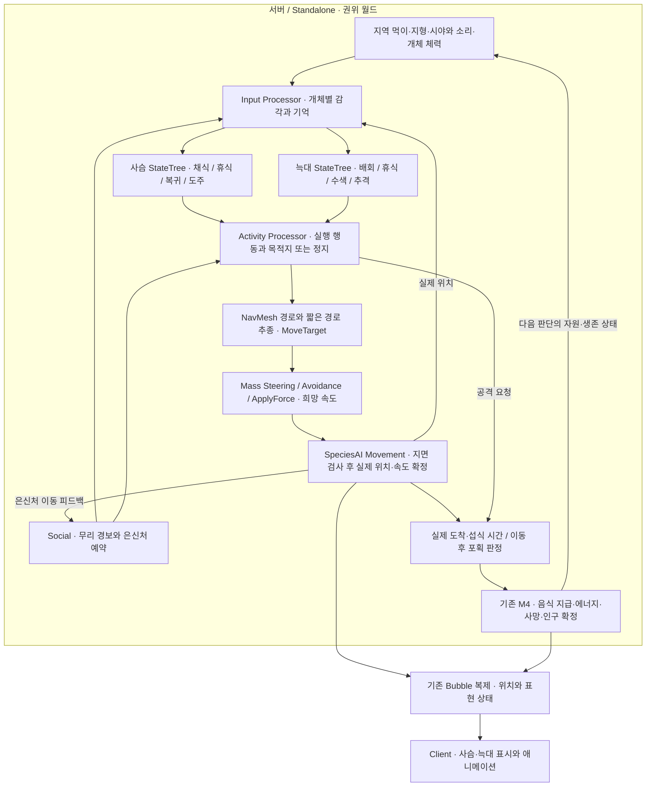

# 사슴·늑대 비강화학습 버전 개발 명세

2026-11-23 · UE 5.8 · `jwj-1115`의 `260ca50c`와 당시 로컬 작업 트리 기준. 다음 단계의 산출물은 **사슴이 풀을 먹다가 늑대를 감지하면 달아나고, 배고픈 늑대가 사슴을 놓치거나 포획하는 과정을 재현할 수 있는 전용 시험 맵**이다. 이 문서에서 제시하는 맵 이름·배치·통과 조건은 개발 제안이다.

## 1. 어떤 버전을 만들 것인가

**기존 `SpeciesAI`의 전체 행동 설정인 `EC_Deer`와 `EC_Wolf`를 사용한다.** 각 동물은 자기 감각·에너지·기억으로 규칙 점수를 계산한다. Mass StateTree가 행동을 고르고, 두 종은 같은 NavMesh·Mass 이동 경로를 사용한다. 첫 개발 단위는 새 AI 클래스 작성보다 **기존 자산으로 한 지역의 먹이 접근과 추격 장면을 끝까지 작동시키는 것**이다. [종별 에셋과 에디터 설정](EDITOR_QUICK_START.md)

| 현재 확인한 경로 | 이번 명세에서의 쓰임 |
|---|---|
| 통합 Native v3에서는 사슴의 학습 정책과 늑대의 Native 규칙이 지역 Step에 연결된다. V1에는 별도의 개체 정책 경로가 있다. | 현행 비교군은 맵·실제 backend를 명시해 별도 실행한다. 늑대까지 모두 PPO를 사용한다고 전제하면 비교 대상을 잘못 잡게 된다. [현재 프로젝트 맥락](../../PROJECT_CONTEXT.md) |
| `/Game/Experiments/SpeciesAI`에 두 종의 EC(EntityConfig), DA(종별 프로필), ST(StateTree), 공용 `SO_ActivitySlot`이 있다. `EC_DeerV1`은 기존 이동과 V1 정책 비교용이다. | 새 시험 맵에는 전체 행동용 두 EC를 연결한다. 권위 Trait의 `bUseSpeciesAI=true`, 프로필의 `bPolicyOnly=false`, 올바른 종별 Tree를 확인한다. 영속 종 ID는 사슴 `Herbivore`, 늑대 `Wolf`다. [템플릿 조립](../../../Source/AdaptiveEcosystem/AI/Behavior/EcoSpeciesAITemplate.cpp) · [에셋 생성 계약](../../../Source/AdaptiveEcosystem/AI/Behavior/StateTree/EcoSpeciesAIAssetBuilder.cpp) |
| 과거 `Integration_Mass_JwJ` 시험 로그에서 사슴이 실제 사용한 설정은 `DA_EcoDeer`였다. 늑대에는 몸체에 맞는 NavMesh를 찾지 못한 오류도 남았다. | 맵 이름이나 화면 속 움직임만으로 판정하면 이 두 문제를 놓친다. 첫 증거로 실제 Template 경로·개체 수·NavData를 기록한다. [기존 현장 기록 §11](../JWJ_LEVEL_EDITOR_TEST_WALKTHROUGH_2026-10-15.md) |

## 2. 전체 구조

**한 장면으로 읽기.** 풀을 먹던 사슴 옆에 늑대가 나타나면 사슴은 위협 단서를 받아 식사를 중단하고 슬롯을 반납한다. 도주 실행기는 마지막 위협 위치에서 벗어나는 목표를 낸다. NavMesh가 경로를 구하고 Mass 조향이 매 프레임 따라갈 속도를 만든다. 늑대도 같은 이동 계층을 쓰되 목표는 자신이 감지한 사슴의 위치다. 벽 뒤에서 시야가 끊기면 늑대는 마지막 단서를 조사한다. 두 개체가 가까워져도 포획은 이동 후 실제 거리·시야·생존 조건을 다시 통과해야 성립한다. 그림의 화살표는 데이터 의존 관계이며, 생태 장부는 자체 시뮬레이션 단계에서 결과를 확정한다.

## 3. 구성 요소와 구현 계약

| 생산자 → 소비자 | 전달 데이터와 소유권 | 실패·취소 시 처리 |
|---|---|---|
| 감각·Social → Input → 종별 StateTree | `FEcoSpeciesAIInputFragment`에 정규화 Energy, 허기, 근거 위치·시각, 직접 시야, 무리·먹이 후보를 개체별로 보관한다. Game Thread가 World 질의를 수행하고 StateTree는 값과 점수를 읽는다. 판단 주기는 프로필 기본 0.25초에 중요도별 1/2/4배를 적용한다. | 개인 관측, 공유 경보, 마지막 기억을 구분한다. 소리만 들은 늑대는 조사할 수 있고 공격에는 최신 직접 시야가 필요하다. [입력과 wake signal](../../../Source/AdaptiveEcosystem/AI/Behavior/EcoSpeciesAIInputProcessor.cpp) |
| 종별 Utility → StateTree → Activity | `ScoreDeer`와 `ScoreWolf`가 점수를 만들고 `UtilityRoot`가 가장 높은 자식을 선택한다. `Decision.Activity`와 `Sequence`가 결정이고 `Execution.Activity`가 실제 행동이다. StateTree Task가 쓰는 `FEcoPolicyOutputFragment::Action`은 이 경로에서는 코드로 만든 Social 호환값이다. 기존 V1 추론 쿼리는 `FEcoStateTreeBehaviorTag`를 제외한다. | 사망·잘못된 입력은 정지, Travel은 여행 목표, 유효한 Shelter 요청은 예약 목표를 사용한다. 일반 활동 슬롯과 Shelter 예약은 각 소유자가 정리한다. [StateTree Task](../../../Source/AdaptiveEcosystem/AI/Behavior/StateTree/EcoSpeciesAIStateTreeNodes.cpp) · [Activity](../../../Source/AdaptiveEcosystem/AI/Behavior/EcoSpeciesAIActivityProcessor.cpp) · [V1 쿼리](../../../Source/AdaptiveEcosystem/AI/Policy/EcoPolicyProcessor.cpp) |
| Activity → Navigation | `FEcoSpeciesAIMoveFragment`의 월드 좌표 목표(cm), 속력(cm/s), 도착 반경(cm), `Revision`을 전달한다. Navigation이 몸체에 맞는 NavData에 투영하고 완전한 경로와 corridor를 만든다. 엔진 PathFollow는 짧은 경로에서 `FMassMoveTargetFragment`를 갱신한다. | 정지 시 이전 경로·힘·희망 속도를 비운다. 투영·경로 실패는 `Failed`와 재시도 시각으로 반환한다. 경로 탐색의 기본 예산은 프레임당 8건과 2ms이며 2ms는 동기 질의 사이에서 확인하는 연성 한도다. [경로 처리](../../../Source/AdaptiveEcosystem/Mass/Navigation/EcoSpeciesAINavigationProcessor.cpp) |
| 엔진 Steering → Avoidance → ApplyForce → 프로젝트 Movement | 엔진이 `FMassForceFragment`와 `FMassDesiredMovementFragment`로 희망 속도를 계산한다. `UEcoSpeciesAIMovementProcessor`가 유효한 경로 revision에 한해 지면·경사·캡슐 sweep·지역 경계를 확인하고 `FTransformFragment`와 `FMassVelocityFragment`에 실제 변위를 쓴다. | 이동이 막히면 실제 진척으로 정체·실패를 판정한다. `FMassCustomMovementTag`로 엔진 기본 위치 적분을 제외하고, `FEcoGroundedNavigationTag`로 기존 사슴 steering·늑대 이동 및 호환 높이 보정이 겹치지 않게 한다. 맵 구성 검사는 stock SmoothHeight 비활성 설정도 검사한다. [최종 이동](../../../Source/AdaptiveEcosystem/Mass/Movement/EcoSpeciesAIMovementProcessor.cpp) · [Trait](../../../Source/AdaptiveEcosystem/Creature/Runtime/EcoCreatureNetworkTrait.cpp) · [템플릿 검사](../../../Source/AdaptiveEcosystem/Creature/Runtime/EcoCreatureTemplateValidation.cpp) |
| 실제 이동·상호작용 → M4 → 복제 | 사슴은 점유하고 저속으로 풀을 먹은 시간을 누적한다. 지역 단계에서 시간·먹이 밀도·Energy 여유로 요청량을 만들고 실제 지급량만 반영한다. 늑대는 이동 후 공격 요청 번호, 관측 신선도, 같은 지역·거리·LOS를 검사해 사망 후보를 기록한다. 기존 coordinator가 사망·개체군·포식 결과를 확정한다. | 한 사슴에 늑대 둘이 동시에 성공을 요청해도 사망과 보상은 한 건이다. 소진된 먹이는 지급량 0, 시야가 끊긴 공격은 거절이다. 클라이언트는 받은 위치·활동을 표현한다. [섭식 거래](../../../Source/AdaptiveEcosystem/Creature/Runtime/EcoCreatureLifecycle.cpp) · [포획 판정](../../../Source/AdaptiveEcosystem/Creature/Runtime/Interaction/EcoSpeciesAIAttackProcessor.cpp) · [기존 복제](../../../Source/AdaptiveEcosystem/Network/Mass/EcoMassReplicator.cpp) |

## 4. 종별 행동과 기획 조정점

| 종·장면 | 들어가는 조건 | 실제 행동과 종료 조건 |
|---|---|---|
| 사슴 · 먹이 | 허기가 높고 같은 지역에 양수의 먹이 밀도를 가진 Graze 장소가 있다. | Forage 선택 → 일반 슬롯 예약 → 보행 → 실제 반경 안에서 점유 → Graze. 위협·슬롯 소실·경로 실패 시 섭식을 중지하고 예약을 정리한다. 먹이 공급이 줄면 다음 선택의 조건도 달라진다. |
| 사슴 · 도주와 복귀 | 직접 위협 또는 유효한 무리 경보가 들어온다. | Flee → 증거 위치에서 멀어지는 지상 목표. 유효한 Social 은신처 요청이 있으면 예약 위치로 이동하고 도착·실패를 보고한다. 위협 해소 뒤 Recover를 거쳐 생활 행동을 다시 고른다. |
| 사슴 · 평상시 | 위협이 없고 휴식·무리 복귀·배회 후보가 있다. | Energy가 높으면 휴식 점수가 올라가고, 무리 위치가 있으면 Regroup이 후보가 된다. 배회 목표는 잠시 유지한다. 한 마리일 때도 유효한 배회·섭식이 가능해야 한다. |
| 늑대 · 탐색 | 배가 고프고 직접 본 먹잇감 또는 최근 단서가 있다. | 최신 시각 단서는 Pursue, 소리·과거 단서는 Search로 연결한다. 마지막 위치를 확인했거나 추적 제한·경로 실패 한도에 이르면 그 표적에 재시도 대기시간을 둔다. 유효한 표적이 없으면 배회·휴식한다. |
| 늑대 · 포획과 식후 | 실제로 접근했고 최신 시야가 있으며 cooldown이 끝났다. | Attack 요청 → 이동 후 재검사 → 성공 시 Eat/cooldown. 보상은 생존 설정과 기존 포식 처리에서 지급한다. Eat는 포획 후 상태이고 별도의 사체 채집 구현은 후속 범위다. |

초기 튜닝은 저장된 DA 값으로 재현하고 실제 값을 Capture manifest에 남긴다. C++ 프로필 기본값은 허기 진입 0.45·해제 0.80, 상태 최소 유지 1초, 진정 3초, 걷기 200cm/s·달리기 650cm/s, 추적 한도 12초다. 허기 진입과 해제 사이에서는 직전 허기 상태를 유지한다. 시험에서 속력·반응 시간을 조절할 때는 소유 프로필 사본에서 한 번에 한 값만 바꾼다. [프로필 기본값](../../../Source/AdaptiveEcosystem/AI/Behavior/EcoSpeciesAIProfile.h) · [사슴 점수](../../../Source/AdaptiveEcosystem/AI/Behavior/Deer/EcoDeerUtility.cpp) · [사슴 실행](../../../Source/AdaptiveEcosystem/AI/Behavior/Deer/EcoDeerExecution.cpp) · [늑대 점수](../../../Source/AdaptiveEcosystem/AI/Behavior/Wolf/EcoWolfUtility.cpp) · [늑대 실행](../../../Source/AdaptiveEcosystem/AI/Behavior/Wolf/EcoWolfExecution.cpp)

## 5. 다음 개발 순서와 완료 기준

**첫 맵 제안**은 `/Game/Experiments/SpeciesAI/Maps/LV_DeerWolf_Mass`다. UE 에디터에서 M4 통합 맵을 소유 경로에 복제하고 World Partition이면 외부 Actor 패키지까지 확인한다. 한 지역 안에 먹이 슬롯 한 곳, 휴식 지점, 시야를 가리는 벽, 돌아갈 수 있는 통로를 둔다. 가려진 뒤에도 목표 위치를 계속 아는지, 직선으로 못 가는 먹이에 실제로 우회하는지를 같은 장소에서 구분할 수 있다.

| 순서 | 작업과 재현 | 다음 단계로 넘어가는 증거 |
|---|---|---|
| 1 · 권위와 구성 | `EcoCreatureIntegrationGameMode`, coordinator 하나, 유효한 Region과 종별 world-space 스폰 지점을 설정한다. 해당 맵에서 `bUseV3Policy=false`, Play 전 `eco.IntegratedPolicyVersion 1`. Ecosystem Life·자연 서식지 프로필·추가 종·wave·이주는 첫 시험에서 끈다. M3 Box Bootstrap을 함께 배치하지 않는다. NavMeshBoundsVolume과 Supported Agents를 확인하고 경로를 빌드한다. | 설정 검사 통과. 서버 로그의 실제 EC 경로와 두 프로필의 `PolicyOnly=0`을 보관한다. 사슴 한 마리가 벽 주위를 돌아 목적지에 도착한다. 유효 경로가 없는 지점에서는 정지·실패·재시도가 관찰되고 벽이나 지역 경계를 관통한 횟수는 0이다. |
| 2 · 사슴 단독 | `DeerOnly`, 사슴 1, 양수의 지역 Food. 먹이 provider의 FoodPatchPosition 근처에서 NavMesh에 닿는 지점에 `EcoSpeciesAIActivitySite`를 두고 같은 RegionId, Kind=Graze, For Predator=false, Definition=`SO_ActivitySlot`을 준다. ID를 확인해 `eco.M4.SetVitals <ID> 1 0.2`로 배고프게 한다. Fixtures=true인 단독 시험에서 도착 후 `EcoSpeciesAIFixture`(Prey=false)를 시야에 노출했다가 숨기고 소리도 끈다. | 같은 ID에서 접근 → 실제 점유 → 첫 먹이 지급 → 위협으로 지급 중단·예약 해제 → 진정과 생활 복귀를 시간순으로 확인한다. 사슴 2마리·슬롯 1개에서도 동시 점유 최대 1, 지급량 합계는 가용량 이하다. |
| 3 · 늑대 단독 | `WolfOnly`, 늑대 1, Predator Survival과 Species AI Fixtures를 켠다. 배고픈 늑대 앞에 Prey 대역을 두고 가시 → 소리만 → 단서 소멸 → 재노출 순으로 바꾼다. | 가시 구간 추적, 소리만 있는 구간 공격 성공 0, 시야 상실 뒤 마지막 단서 수색 및 포기를 확인한다. 대역 포획은 별도 카운터에만 기록하며 실제 사슴 사망·인구 변화는 0이다. |
| 4 · 실제 두 종 | `Both`, 사슴 4·늑대 1, **Fixtures=false**. 포식자 생존을 켠다. 먼저 가림벽으로 도주 성공 장면을 만들고 다음 실행에서는 시야가 열린 짧은 거리에서 실제 포획을 재현한다. 경쟁 시험은 늑대 2마리에 스폰 좌표도 2개를 준다. | 사슴과 늑대 양쪽 ID의 결정·경로·실제 위치를 대조한다. 포획 성공 장면은 피해 사슴 한 마리, Predation 사망 1회, 지역 사슴 수 −1, 포획 보상 1회다. 도주 성공 장면에서는 동일 표적에 대해 이 세 거래 모두 0이어야 한다. |
| 5 · 네트워크와 비용 | 같은 맵을 Dedicated Server + Client 2개에서 실행한다. 근접·원거리·관전자 부재 조건을 나눠 서버 판단과 표현을 확인한다. 규모 시험은 같은 시드·배치에서 수를 늘리며 서버 프레임 시간 p95, 경로 대기 시간, 실패·정체 수를 기록한다. | 서버 권위 개체 수와 생태 장부가 일치하고 클라이언트 권위 행동·이동·포획 실행은 0이다. 기존 설정의 비교 맵도 별도로 시작해 종전 backend를 확인한다. 하드웨어·측정 구간·개체 수가 붙은 실측을 다음 규모 목표의 기준으로 남긴다. |

**확인 도구.** 서버에서 `eco.M4.Dump details`로 ID·생존 상태를 읽고, `eco.SpeciesAI.Status`로 실제 참여 수와 경로·활동을 본다. `eco.SpeciesAI.Capture`를 위협 직전·직후·도착 후에 실행하면 `Saved/SpeciesAI`에 CSV와 manifest가 남는다. 같은 ID의 `Decision`, `Activity`, `NavStatus`, `MoveRevision`, `SlotReservation`, `AttackResolved`, `AttackSuccess`, Energy를 비교한다. CSV는 순간 기록이다. 실제 궤적·단일 writer 호출 횟수·프레임 시간은 Mass Debugger 또는 Unreal Insights와 위치 기록으로 보완한다. 실행 결과가 완료 기준에 미달하면 해당 단계의 맵 설정과 입력부터 확인하고, 재현된 차이가 있는 소유 모듈만 수정한다. [진단 출력 정의](../../../Source/AdaptiveEcosystem/Debug/EcoSpeciesAIDiagnostics.cpp)

**비교의 해석.** 같은 맵·시드·초기 위치·Energy·먹이량·모의 시간에서 현행 버전과 이 버전을 각각 실행해 첫 위협→도주 지연, 먹이 도착·지급, 추격 성공/포기, 정체 시간, 서버 비용을 비교한다. 속력·감각·먹이 규칙처럼 동일하게 맞출 수 없는 값은 결과 옆에 적는다. 두 종의 결정·경로·섭식까지 함께 바뀌므로 이 비교로 평가하는 것은 **플레이되는 전체 버전**이다. 사슴의 정책 선택 효과만 분리하는 실험에는 기존 V1 전용 비교 절차가 있다. [비교 실험 계약](../MASS_STATETREE_PPO_COMPARISON_DEVELOPMENT_PLAN_2026-10-14.md)

Native v3 전용 Life·자연 출생·공간 먹이 격자·체크포인트·지역 사슴의 플레이어 경험까지 연결하려면 별도 어댑터와 검증이 필요하다. 이 시험의 생태 범위는 기존 SpeciesAI가 이용하는 지역 자원·생존·포식 거래다. 여기서 코드나 빌드 입력을 후속 수정할 경우 저장소 규칙에 따라 중복 빌드 여부를 먼저 확인하고 직접 UBT로 `AdaptiveEcosystemEditor Win64 Development`를 빌드한 뒤 해당 장면을 다시 검증한다. [구성 검사](../../../Source/AdaptiveEcosystem/Creature/Runtime/EcoCreatureSetupValidation.cpp) · [기존 검증 범위](IMPLEMENTATION_MILESTONES.md)

## 6. 공식 문서와 게임 AI 기술 자료를 적용한 근거

| 자료 | 이 명세에 적용한 결정 |
|---|---|
| Epic Games, *MassGameplay Overview* | 스폰·표현·LOD·복제와 Mass 행동의 역할을 구분한다. 프로젝트에서는 기존 coordinator와 Bubble을 연결 지점으로 사용한다. [Epic 공식 문서](https://dev.epicgames.com/documentation/en-us/unreal-engine/overview-of-mass-gameplay-in-unreal-engine) |
| Epic Games, *StateTree Selectors Overview* | Highest Utility는 진입 가능한 자식 중 최고 점수를 선택하며 동점에서는 자식 순서가 영향을 준다. 종별로 선택 이유를 재현할 때 입력 점수와 트리 순서를 함께 확인한다. [Epic 공식 문서](https://dev.epicgames.com/documentation/unreal-engine/statetree-selectors-overview) |
| Epic Games, Mass Navigation / Movement API | MoveTarget의 중심·희망 속력과 DesiredMovement의 희망 운동은 서로 다른 단계다. 도착·점유 판정은 이후의 실제 몸 위치에서 한다. [FMassMoveTargetFragment](https://dev.epicgames.com/documentation/unreal-engine/API/Plugins/MassNavigation/FMassMoveTargetFragment?lang=en-US) · [FMassDesiredMovementFragment](https://dev.epicgames.com/documentation/unreal-engine/API/Plugins/MassMovement/FMassDesiredMovementFragment) |
| Craig W. Reynolds, *Steering Behaviors for Autonomous Characters*, GDC 1999 | 행동 선택·조향·실제 운동을 나눈 구조를 채택했다. 사슴의 도주와 늑대의 추격은 서로 다른 목표를 만들고 같은 조향·이동 계층을 사용한다. [저자 논문](https://www.red3d.com/cwr/papers/1999/gdc99steer.pdf) |
| Andrew Fray, *Context Steering*, Game AI Pro 2, 18장 | 추적과 장애물 회피의 방향 요구가 충돌할 수 있다는 사례를 가림벽·우회 시험으로 옮겼다. 첫 버전의 조향 구현은 엔진 Mass Steering/Avoidance를 사용한다. [저자 기술 해설](https://www.gameaipro.com/GameAIPro2/GameAIPro2_Chapter18_Context_Steering_Behavior-Driven_Steering_at_the_Macro_Scale.pdf) |
