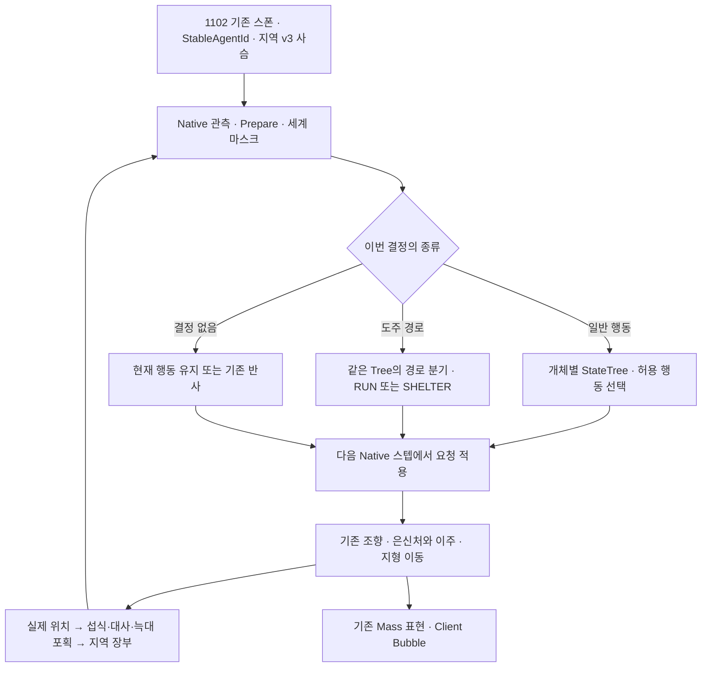

# 1102 레벨의 v3 사슴 행동 선택을 StateTree로 전환하는 개발 명세

2026-11-25 · 구현 전 명세 · UE 5.8 · `jwj-1115` / `260ca50c` 및 로컬 작업 트리 기준

구현 이후 1102에서 수동으로 확인하는 순서와 실제 콘솔 명령은 [1102 수동 확인 안내](JWJ_1102_DEER_STATETREE_PLAY_GUIDE.md)에 있다.

## 1. 목표와 성공 장면

1102의 기존 스폰 위치에서 태어난 같은 Mass 사슴이 **개체별 StateTree로 행동을 선택**한다. 서버의 v3 실행기는 그 선택을 받아 걷기·달리기·정지, 실제 지형 이동, 현 위치에서의 먹이 소비와 대사를 처리한다. 늑대는 기존 Native 규칙으로 이동 후 사슴을 감지·포획한다. 행동을 바꾸면 이동 경로와 섭취 결과는 달라질 수 있다. 보존 기준은 동일한 조건에서 적용되는 세계 규칙, 실제 위치, 거래 주체와 기록 횟수다.

11월 25일 저장본 조사에서 coordinator는 `JWJ_WildlifeTest_Runtime`, 설정은 `EC_JYU_V3_Deer`와 `EC_JYU_V3_Wolf`였다. Use V3 Policy·Ecosystem Life·Vegetation·Herd Journeys가 켜져 있었다. 5개 그룹의 저장 수량은 사슴 48, 늑대 6이다. 기존 설정 검사 결과는 Errors=0이며, 새 경로의 실행 검증은 후속 작업이다. 첫 수용 장면은 **JWJ_WildlifeTest에서 기존 먹이를 먹던 사슴이 실제 늑대를 감지해 도주하고, 진정 후 다시 먹이를 소비하는 것**이다.

## 2. 운영 구조와 변경 지점

기존 SpeciesAI에서 가져올 부분은 **공유 트리 에셋, 개체별 입력·실행 상태, Evaluator → 선택 → Task 출력** 구조와 사슴의 허기·위협 선호다. 기존 `ST_Deer`의 Task는 V1 호환 `FEcoPolicyOutputFragment::Action`을 쓰고, 전체 행동용 `EC_Deer`는 별도 이동·슬롯 섭식 경로를 구성한다. 1102용으로는 v3 요청을 쓰는 전용 노드와 트리를 만든다. 기존 11월 24일 지면 이동·슬롯 구현은 독립 시험 레벨에서 계속 사용할 수 있다. [기존 StateTree 노드](../../../Source/AdaptiveEcosystem/AI/Behavior/StateTree/EcoSpeciesAIStateTreeNodes.cpp) · [사슴 규칙](../../../Source/AdaptiveEcosystem/AI/Behavior/Deer/EcoDeerUtility.cpp) · [독립 레벨 명세](DEER_WOLF_MASS_GAMEPLAY_SPEC_20261123.md)

**교체 위치는 `EcoWorldV3::DecideHerb`의 추론 호출 경계다.** 여기서 Prepare와 마스크 작성 후, 기존 PPO 또는 새 StateTree 중 하나만 요청을 생산한다. 일반 결정은 스텝 끝 H에서 준비되어 다음 스텝 A에서 Commit된다. 도주 중의 길 선택에도 독립적인 망 호출이 있다. 이동 직전 `IntegratedControlHook`만 바꾸면 이미 요청 추론이 끝난 상태이므로 사슴 PPO 호출 0회를 달성할 수 없다. [결정 함수](../../../Source/AdaptiveEcosystem/AI/Policy/EcoWorldV3.h) · [통합 Step과 제어 훅](../../../Source/AdaptiveEcosystem/AI/Policy/EcoPolicyV3IntegratedProcessors.cpp)

## 3. 구현 계약

| 항목 | 구현할 동작 |
|---|---|
| 월드 시작 | 제안 옵션 `-EcoDeerDecision=StateTree`를 권위 월드 생성 시 읽는다. 미지정은 기존 PPO다. 1102의 Use V3 Policy는 켠 채 기존 v3 사슴·늑대 템플릿을 구성한다. 옵션은 세션 시작부터 종료까지 고정한다. 전용 트리의 로드·컴파일·스키마 검증이 실패하면 첫 스폰 전에 원인을 출력한다. |
| 실행 주체 | 통합 Step을 소유하는 Game Thread에서 개체별 StateTree를 동기 평가한다. 첫 구현은 값 입력만 받는 전용 StateTree schema와 개체별 instance data를 사용한다. v3 Mass 템플릿에 기존 SpeciesAI 태그·stock Mass StateTree tick을 얹지 않는다. 기존 검증은 v3와 해당 태그/인스턴스의 혼용을 금지한다. [템플릿 검사](../../../Source/AdaptiveEcosystem/Creature/Runtime/EcoCreatureTemplateValidation.cpp) |
| 스텝 경계 | 엔진 독립적인 Native 헤더에는 값 형식의 결정 입력·출력과 선택 콜백만 둔다. 통합 어댑터가 행과 StableAgentId를 연결한다. 최초/새 행의 `ObserveAndDecideRows`, A의 미준비 행 보정, H의 `DecideAll`, 도주 경로 선택까지 동일한 선택기를 전달한다. 기존 독립 호출자는 기본 PPO 동작을 사용한다. 한 프레임에 여러 Native 스텝을 처리해도 각 스텝의 관측으로 선택한다. |
| 입력 | WorldEpoch·StableAgentId·지역·Native 스텝·결정 종류, 현재 행동과 Prepare 결과, 최종 허용 마스크, 정규화 에너지·어둠·지각된 위협과 엄폐 가능성·기존 관측의 먹이 정보를 읽기 전용 snapshot으로 제공한다. StateTree는 World를 재검색하거나 늑대의 숨은 실제 위치를 읽지 않는다. |
| 출력 | 일반 결정은 행동 요청 하나, 경로 결정은 경로 요청 하나를 반환한다. 어댑터가 종류·스텝·ID·허용 비트를 검사한다. 같은 결정의 중복 호출은 기존 결과를 재사용한다. 유효 후보는 반드시 선택하도록 트리를 구성하고, 런타임의 잘못된 결과는 유효한 현재 행동 또는 정해진 순서의 첫 허용 후보로 처리해 오류를 집계한다. 허용 후보가 전혀 없으면 진단 실패로 기록하고 해당 시험 실행을 중단한다. 검증 실패나 트리 오류 시 PPO로 우회하지 않는다. |
| 개체 수명 | 에셋은 공유하고 런타임 상태는 월드·개체별로 둔다. 새끼는 첫 판단 전 초기화하고, 같은 개체의 이주에서는 상태를 보존하되 출발 지역의 미소비 요청은 폐기한다. 사망·삭제·월드 종료 시 해제한다. 행 번호·Mass 핸들을 영속 키로 사용하지 않는다. |
| 저장·복제 | Client에는 기존 위치·활동 DTO만 전달한다. 저장을 지원하는 단계에서는 backend·트리 버전·개체별 지속 상태·준비된 요청의 경계를 함께 보존한다. 기존 저장본은 PPO 계약으로 읽는다. 초기 시제품에서 StateTree 저장 왕복이 준비되지 않았으면 해당 모드의 저장/복원에 명시적 미지원 결과를 반환한다. |

**스케줄링 선행 확인.** UE StateTree는 같은 상태가 계속 활성일 수 있다. 후속 구현의 첫 실험은 동일 프레임에 들어온 연속 결정 두 개에서 입력이 바뀌면 자식 선택과 Task 출력도 바뀌는지 확인하는 것이다. 일반/경로 분기 각각에 요청 일련번호를 전달하고, 매 결정 시 루트 재선택과 새 결과 생성을 보장한다. 기존 SpeciesAI의 초 단위 DecisionInterval·MinimumDwell은 여기에 추가하지 않는다. 기존 v3의 행동 잠금과 반응 지연은 Prepare/Commit이 관리한다.

## 4. 사슴 트리의 첫 행동 규칙

아래는 구현 제안이다. **종별 선호도는 트리가 정하고, 지금 가능한 선택지는 기존 세계 마스크가 정한다.** 같은 입력에서 결과가 재현되도록 동점 우선순위를 에셋에 고정한다.

| 결정 종류와 상황 | 트리 출력 | 기존 실행기가 적용할 내용 |
|---|---|---|
| 일반 · 허기/평상시 | 가능하면 `GRAZE(0)`. 먹이 관측과 에너지를 선호도에 반영 | 기존 먹이 방향·군집 보정·실제 섭식. 독립 SpeciesAI의 Wander/Regroup은 별도의 v3 행동 번호로 만들지 않는다. |
| 일반 · 위험 | 지각과 마스크에 따라 `FLEE(1)`, `HIDE(2)`, `FREEZE(3)` 중 가능한 자식만 평가. 가령 도주 허용 시 도주, 엄폐가 가능하면 숨기, 남은 허용 후보에서 경계 정지를 선택한다. | 행동 잠금·도주 반사·엄폐 도착·안전 판정은 기존 코드가 적용한다. R7e의 반사 밖 FLEE 제한도 현재 마스크를 따른다. |
| 일반 · 포만/야간 휴식 | 위협이 낮고 휴식 조건이 맞을 때 허용된 `SLEEP(4)`를 선택한다. | 기존 수면·기상 규칙과 대사를 적용한다. |
| 도주 반사 중 경로 결정 | 경로용 허용 비트와 기존 경로 관측으로 선택한다. 첫 규칙은 엄폐 경로가 유효하고 허용되면 `SHELTER`, 그 밖에는 허용된 `RUN`이다. | 실행 요청은 기존 반사의 FLEE다. **경로 채널에서 4는 SHELTER, 일반 행동 채널에서 4는 SLEEP**이다. 경로 출력은 `RouteRequest`를 통해 다음 A의 경로 적용으로 보낸다. |
| 잠금/비결정 또는 경로 선택이 없는 강제 반사 | Tree 평가를 건너뛴다. | 기존 행동 유지 또는 기존 `CommitFlight`를 적용한다. |

기존 가중치·관측 스키마·허용 마스크는 이 작업의 입력 계약이다. 튜닝 대상은 전용 StateTree의 조건·점수·동점 순서다. 일반 행동과 경로 요청의 마스크·로그도 각 채널로 기록한다. [행동 번호와 실행기](../../../Source/AdaptiveEcosystem/AI/Policy/EcoRepertoire.h)

## 5. 구현 순서와 완료 증거

1. **선택기 경계 추출.** Native 기본 경로에서 기존 행동/길 요청과 Commit 순서를 보존한다. 실제 망 호출 지점과 StateTree 결과 생산 지점에 개별 계측을 둔다. 기존 `Decisions` 합계에는 길 결정도 들어가므로 추론 횟수의 대용으로 쓰지 않는다.
2. **전용 트리와 통합 어댑터.** 1102를 수정하지 않고 서버 시작 옵션으로 전용 트리를 선택한다. 개체별 상태 등록, 최초·신규 행·다중 스텝, 정상·경로 양쪽 결정을 연결한다. 에셋은 소유 실험 경로에 저장하고 빌드/패키지에서 참조 가능한지 확인한다. 모델 교체·실시간 적응 기능이 시험 중 backend를 바꾸거나 사슴 PPO를 호출하지 않도록 점검한다.
3. **1102 한 지역에서 사용자 수동 확인.** 기존 배치 그대로 `JWJ_WildlifeTest`의 사슴 ID를 관찰한다. 진단에 backend, 스텝, 결정 종류, mask, 요청, 반사, 실행 행동, 실제 변위, 섭식 지급량을 남긴다. 허기·도주·진정 장면에서 **실제 트리 선택 ≥1, 해당 사슴 일반/경로 PPO 호출 각각 0, 마스크 위반 0, 중복 위치 적분 0**을 확인한다. 경로 분기까지 검증하려면 경로 결정이 실제로 1회 이상 발생해야 한다.
4. **전체 5개 지역과 수명 확인.** 서버의 실제 스폰 수를 시작 로그와 대조한다. 늑대가 도주 후 실제 사슴 위치를 추적하고 포획 한 건에 사망·개체군·영양이 한 번씩 반영되는지 본다. 실제 섭식량과 자원 장부, 이주 전후 동일 ID·인구 수지, 신규/삭제 상태 정리, Dedicated + Client 2의 수신 표현을 확인한다. 저장 지원 완료 표시는 같은 모드의 새 프로세스 복원 뒤에만 한다.
5. **기본 모드 회귀와 비용.** 동일 맵·초기 조건·시드로 PPO 세션과 StateTree 세션을 따로 실행한다. 서버 프레임 p95, 결정당 시간, 먹이 접근·섭취량, 도주 지연, 장기 생존을 기록한다. 행동 차이로 궤적이 갈라진 이후에는 장부 보존·유효한 행동·시간 분포로 비교한다. 구현 시 직접 UBT Editor 빌드 후 플레이 검증은 사용자가 시작한다.

첫 개발 단위는 **한 마리의 StableAgentId에서 첫 결정부터 실제 섭식까지 ‘StateTree 요청 → Native 실행 → 실제 결과’를 추적할 수 있는 것**이다. 첫 단계의 재배치 비용은 전용 트리 에셋과 시작 옵션 구성에 한정하며, 1102에 새 NavMesh나 Graze 슬롯을 배치하는 작업은 이 설계의 선행 조건이 아니다.
