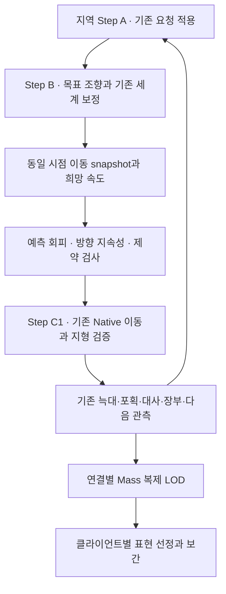

# 지역 생태계 조향·회피 통합 계획과 개발 명세

2026-11-12 작성. 확인 기준은 `jwj-1024`, HEAD `ef44df1597589416b16fceaa496341541a4400a3`와 당시 로컬 작업 트리다. 설치 엔진은 UE 5.8.3, CL 58210709다. 상태는 **개발 계획**이며 이번 작성에서는 문서와 링크를 검증했다. 구현·UBT·PIE·성능 측정 결과는 후속 실행 기록에 남긴다.

사용자는 지역별 Step의 관리 단위를 활용하면서 자연스러운 이동, 예측 회피, 클라이언트별 전송·표현 최적화를 진행할 계획과 명세를 요청했다. 이 문서는 [RL 보존 통합 계획](RL_PRESERVING_EPIC_MASS_PLAN_20261112.md)의 조향·회피 단계를 구체화한다. [06 계측](06_INSIGHTS_MASS_DEBUGGER_20261112.md), [07 평상시·도주](07_GRAZE_FLIGHT_LOCOMOTION_20261112.md), [08 에디터 확인](08_EDITOR_MOVEMENT_TRACE_QUICK_TEST.md)을 함께 사용한다. 동족 탐색 P0/P1과 기존 전체 계획의 우선순위는 해당 계약을 따른다.

## 1. 현재 사실과 이번 설계의 출발점

| 확인한 사실 | 개발에 적용할 의미 |
|---|---|
| 지역별 통합 Processor가 GT에서 `EcoWorldV3::Step`을 호출 | 지역별 실행과 자원 경계를 유지하며 내부 계산 입출력을 명시 |
| Step A가 이전 요청을 적용하고 H가 다음 요청을 준비 | 함수 분리 중 감각·판단·적용 시점과 RNG 순서를 유지 |
| `kStepSeconds=8/60`초, `DecideHerb`의 실제 추론은 조건부 | 7.5Hz 시뮬레이션과 행동 선택 횟수를 각각 기록 |
| B에서 Control/Flight, IntegratedControlHook, 약화, 날씨 순으로 속도 계산 | 초기 회피의 삽입 경계는 B 완료 뒤, C1 진입 전 |
| C1에 기존 원판 detour·ApplyMove·지형 검사와 대체 이동이 있음 | 회피 제안과 최종 실제 이동을 각각 검사하고 기록 |
| 현재 동족 분리는 위치·거리 기반, 전체 조향은 먹이·무리 중심·위협·목표도 소비 | 새 회피와 기존 분리의 기여를 분리 계측 |
| 늑대는 `EcoThreatV3::Step` 규칙으로 이동·포획 | 사슴 회피와 늑대 회피를 순차 적용하며 포획 시점 보존 |
| 기존 CSV에 pre_hook/final/actual 방향과 정책 읽음 등이 있음 | 기존 기록기를 확장하고 중복 기록 시스템 생성은 피함 |
| Client Bubble에 LOD별 interval gate, 표현에 거리·풀·보간이 있음 | 서버 계산, 연결별 전송, 카메라 표현을 독립적으로 평가 |

주요 근거 파일은 §11에 연결했다. 이동 계측의 빌드 이력은 08에 있다. 이번 문서에서는 해당 실행을 재수행하지 않았다. 사용자 관찰의 좌우 흔들림은 아직 원인 확정 전이다.

## 2. 구현 목표와 책임

완료 목표는 같은 목표를 향한 이동 중 급격한 방향 반전·근접 겹침·무진행을 줄이고, 도착·섭식·도주·포획과 생태 수지를 함께 검증하는 것이다. 모델/관측/정규화/mask/보상/추론과 기존 판단 주기는 활성 RL 계약을 따른다. 늑대 학습은 별도 RL 과제다.

회피는 기존 행동과 목적지가 만든 이동 요청을 보정한다. Native가 개체별 위치·대사·섭식을 최종 확정하고 실제 위치로 예약/이주 feedback을 발행한다. 계층 구분은 Reynolds의 행동 선택·조향·locomotion 설명을 참고한 프로젝트 적용안이다. [Reynolds, GDC 1999](https://www.red3d.com/cwr/steer/gdc99/)

첫 구현은 기존 Native 내부의 순수 계산 helper로 시작한다. 이후 필요성이 확인된 계산만 Mass Processor로 분리한다. Epic Processor 직접 사용은 필요한 Fragment·공간 grid·단위·실행 시점 adapter의 비용을 비교해 결정한다. 설치 엔진의 `FMassCustomMovementTag` 제외와 개체별 단일 movement writer 계약을 적용한다.

## 3. 단계별 개발 계획

아래 작업 번호는 이 문서의 순서이며 기존 통합 계획 M0~M5와 연결한다. 각 단계는 독립 diff와 실행 기록으로 제출한다.

| 단계 | 산출물과 대상 | 완료 조건 |
|---|---|---|
| 1 기준선과 원인 판별 | 08 CSV·Insights 재사용, 목표/기여도/화면 회전 기록 보강, §9 manifest | 흔들림을 행동/목표/조향/지형/표현으로 판별하는 시계열과 비교 영상 확보 |
| 2 정확 탐색·실행 경계 | 기존 P1 정확 후보 비교, B/C1 입출력과 snapshot 추출 | OFF의 필드·RNG·장부 결과 일치, 실제 실행 순서 동일 |
| 3 사슴 회피 shadow | §4~6 계약, 후보 예측·출력·거절 이유 기록 | shadow의 권위 결과 일치, snapshot 오류 및 비유한 출력 0 |
| 4 사슴 owned opt-in | 기존 분리 유지 profile부터 회피 실행, 원인에 따른 07 보정 하나씩 비교 | §9 이동·긴급·도착·비용 gate 통과 |
| 5 늑대·포식 관계 | §7의 늑대 제어 추출과 관계별 회피, 실패/포획 회귀 | OFF 위협 Golden 유지, 사냥 fixture와 자원/사망 receipt 검증 |
| 6 병목 통행·지역 경계 | §6의 통로 양보, 별도 경계 fixture | 공정성·실제 도착·예약 해제 확인, 지원 경계 명시 |
| 7 복제·표현 최적화 | §8의 연결별 관심도·High/Low 선정·기존 보간 | 권위 결과 일치, Client2/경계/late join 검증과 전송·화면 비용 비교 |

단계 7은 단계 1 기준선 이후 독립적으로 진행할 수 있다. worker 분리는 기존 M4 계약의 snapshot 수명·의존성과 병목 결과가 확보된 뒤 수행한다. 단계 1~4가 첫 구현 묶음이며 단계 5~7은 후속 묶음이다. 기본 설정 전환은 실제 품질·생태 평가 결과를 보고 결정한다.

## 4. 이동 입력·출력 계약

다음 이름은 **제안 데이터 이름**이다. 구현 시 기존 Rep/Body/Control/Decision/Travel/lease 필드를 우선 재사용한다. 한 스텝 scratch와 여러 스텝의 실행 기억을 구분한다.

| 데이터 | 필수 내용 | 소유/수명 |
|---|---|---|
| MotionToken | world/session, global step, region runtime index와 generation, agent generation, profile revision | 해당 작업 입력과 결과를 검증하는 키 |
| MotionInput | StableAgentId, 몸 중심과 실제 반경, 직전 실제 속도, B 이후 희망 속도, 실행 행동·Gait·Keep, 정지 상태, 기존 목표 ID/revision, 여행/slot 유효성 | GT gather, 해당 phase 불변 |
| MotionConstraints | 희망 속도에서 유도한 허용 최대 속도, 선택 행동의 방향 조건, 정지/안전영역/유효 corridor 제약 | 기존 실행 계층이 제공 |
| NeighborSnapshot | ID/generation, 위치·속도·반경, 높이/지면 연결 정보, 이동/정지 구분, 관계 분류 | phase별 불변, live Mass 포인터 저장 금지 |
| AvoidanceOutput | 제안 속도, 최소 예측 간격, 가장 위험한 상대 ID, 후보 수/누락 여부, 적용/거절 사유 | scratch, Body/행동/자원 쓰기 권한 없음 |
| LocomotionMemory | 채택 시 필요한 회피 측면/목표 revision/유지 종료 step/양보 나이 | 개체별 영속 실행 상태, reset·저장 계약 필요 |
| ActualMotion | 적용 제어, 실제 변위/heading, detour/막힘/재시도, 도착/섭취 결과 | 기존 Native 결과와 feedback 재사용 |

계산 단위는 helper 입출력에서 Native 길이/step으로 통일한다. `1 unit=200cm`, `dt=8/60초`다. UE cm/s 입력은 기존 변환 함수를 사용한다. 예측 시간은 `HorizonSteps`로 명시하며 사용자 설정의 초 값을 경계에서 한 번 변환한다. 몸 반경은 authoritative body/체형에서 얻고 시각 mesh 경계와 분리한다. 반경 자체의 기본값 변경은 별도 실행 profile 변경으로 기록한다.

사슴 snapshot은 B가 모든 사슴의 제어를 완료한 뒤 C1 이전의 위치를 기준으로 고정한다. 사슴 상호 회피에는 같은 phase의 희망 속도와 직전 실제 속도를 구분해 전달한다. 이미 갱신된 앞 row의 위치를 뒤 row가 읽는 혼합을 금지한다. 늑대 C2의 기존 순차 의미는 §7을 따른다.

구조 변경·죽음·이주·restore·world teardown 이후 token이 다르면 결과를 폐기한다. 기존 유효 제어를 실행하고 거절을 계측한다. 원시 row/index 캐시는 저장하지 않는다. 동작을 바꾸는 측면 기억·양보 상태는 checkpoint payload와 runtime/profile 호환성에 포함하거나 명시적인 복원 비지원 조건을 둔다. 포맷 번호는 구현 당시 실제 값을 확인한다.

## 5. 회피 알고리즘과 적용 위치

### 5.1 예측과 후보 검색

초기 shadow는 상대 위치 `r=p_other-p_self`, 상대 속도 `u=v_other-v_self`에서 최근접 시간을 `t=clamp(-dot(r,u)/dot(u,u),0,HorizonSteps)`로 계산한다. 상대 속도가 거의 0이면 현재 간격을 사용한다. `length(r+u*t)`와 두 몸 반경 합+여유 간격을 비교한다. 겹친 중심의 정규화에는 StableAgentId 쌍으로 결정한 방향을 사용한다. 이 수식과 이후 제약은 프로젝트의 초기 설계이며 Epic 구현 복제나 충돌 회피 보장으로 해석하지 않는다.

검색 범위는 몸 반경과 상대 최대 이동거리·예측 시간을 반영한다. 단순 근거리 순위만으로 빠르게 접근하는 개체를 누락하지 않도록 충돌 예상시간·예측 간격·ID 동점 순서를 비교한다. 후보 K 제한, 방문 셀/항목 예산, overflow 계측은 [01](01_NEIGHBOR_AVOIDANCE.md)과 기존 bounded 명세를 따른다. 정책의 KinCount/FleeCount/KinAlarm/ToCentroid 생산은 기존 정확 질의를 사용한다.

첫 correctness fixture에는 충분한 후보를 사용하는 참조 계산을 둔다. 이후 bounded 후보의 위험 상대 누락률과 비용을 비교한다. overflow는 `Clear`로 표시하지 않고 `IncompleteCandidates`로 남긴다. 추가 예산·기존 제어 fallback 등 실제 정책을 profile에 명시하고, 포화 fixture를 통과한 범위만 지원 규모로 기록한다.

예측 기반 force와 주변 공간 grid의 개념은 Epic Mass Avoidance를 참고한다. 실제 API는 설치 5.8.3 소스로 대조했다. [Epic Mass Avoidance](https://dev.epicgames.com/documentation/unreal-engine/mass-avoidance-overview-in-unreal-engine)

### 5.2 제어 합성과 기존 분리

첫 실행 profile은 **현재 B의 최종 희망 속도 + 예측 회피 보정**이다. 회피 계수/최대 보정량은 설정으로 분리하고 현재 Separation과 신규 보정의 방향·크기를 함께 기록한다. 기여도 기록을 위해 함수 추출이 필요하면 OFF 계산 순서·정밀도를 그대로 검증한다.

비교 profile에서 기존 Separation을 새 근접 분리로 대체하려면 목표 조향을 생산하는 시점에서 그 기여를 한 번만 교체한다. 정규화와 후속 hook을 거친 최종 속도에서 원래 분리 벡터를 빼는 방식은 사용하지 않는다. 교체 profile은 별도 A/B 실험이며 기본 profile과 결과를 합산하지 않는다.

회피의 적용은 B 루프 완료 뒤 C1 앞이다. 약화·날씨·체형이 반영된 속도를 입력받고 보정 후에도 해당 속도 상한을 지킨다. FREEZE/SLEEP/웅크림/도착 정지에는 기존 위치 정지를 적용한다. 정지 개체는 움직이는 동료가 피할 대상이 될 수 있다.

회전율·가속 제한을 넣을 때는 **제약을 적용한 최종 후보**로 예측 위험을 다시 계산한다. 후처리 평활화가 안전한 방향을 위험한 방향으로 되돌리는 것을 검사한다. 평상시 지속성은 기존 긴급 진입 시 무효화한다. 실패 시 속도 감속/정지 여부도 실행 동작 변경으로 기록하고, 도주·여행 허용 조건을 확인한다.

C1의 기존 detour·지형 retry가 회피 이후 방향을 다시 바꿀 수 있다. 최초 shadow에서 원래 제어, 회피 후보, 지형 후 실제 변위를 각각 비교한다. ON profile에서는 최종 대체 이동 후보도 같은 회피 snapshot으로 확인한다. 새 공간 index를 스텝 도중 live 위치로 갱신하지 않는다. 유효 후보가 없으면 `Blocked`와 원인을 남기고 기존 소유자에게 전달한다. 실제 이동 결과만 도착·점유·섭식의 근거로 사용한다.

### 5.3 정적 장애물과 지면

현재 Native 원판 장애물·기존 terrain validation을 우선 사용한다. 일반 지형의 벽/가장자리를 예측 입력으로 제공하려면 기존 지면 backend에서 권위 높이·경계 정보를 만드는 GT adapter가 필요하다. scenery mesh를 임의로 장애물 목록에 추가하지 않는다.

지면 입력에 없는 장애물은 기존 이동 검사의 적용 범위를 실행 기록에 명시한다. 시각적으로 겹친 다층 지형의 개체를 2D 이웃으로 처리하지 않도록 지원 지면/연결 조건을 검사한다. 현재 2.5D 한계와 cross-region 지각 계약은 유지하며, 경계 간 이동 회피를 확장하는 작업은 단계 6의 별도 snapshot 계약에서 다룬다.

## 6. 좌우 진동과 좁은 통로

회피 측면을 유지할 필요가 확인되면 ID 쌍과 상대 진행 방향으로 결정적인 동점 해소를 사용하고, 동일 충돌 상대·유효 목표에 대해 짧은 유지 시간을 실험한다. 목표/상대 소멸·지역 이전·긴급 전환·측면 통로 폐쇄 시 즉시 재평가한다. 임의 RNG draw를 추가하지 않는다.

좁은 통로에서 양쪽 진행 후보가 모두 무효라면 개체별 방향 반전만 반복하지 않도록 다음 후속 절차를 실험한다.

1. 소유된 corridor ID와 입구/출구·폭이 있는 fixture에서만 통행 조정을 시작한다. 기존 이주 경로·예약 소유자에 통행 상태를 부착한다.
2. 진행 중인 통행을 우선하고, 대기자의 age와 StableAgentId로 다음 순서를 결정한다. 일반 양보는 이동 실행 상태로 표현한다.
3. 유효한 대기 공간에서 기다리고, 뒤로 이동해야 한다면 권위 경로가 검증한 위치만 사용한다. 안전한 대기 공간이 없으면 무진행을 기록한다.
4. 반대편도 양보하는 교착, 한 방향의 영구 독점, 사망·취소·이주·timeout 이후 점유 잔류를 검증한다.
5. 긴급 도주 시 평상시 양보의 적용 자격을 해제하고 기존 위협·안전 제약을 재평가한다. 물리적으로 막힌 통로의 통과 성공을 가정하지 않는다.

통행 시간·도착 가능성·혼잡은 경로 수준 평가에 포함한다. 큰 군중에서는 국소 회피와 경로 비용을 함께 다루어야 한다는 개발 사례를 참고했다. 이번 초기 구현의 통로 계약은 위 제안 절차로 한정한다. [Game AI Pro 2, Graham Pentheny, Chapter 17](https://www.gameaipro.com/GameAIPro2/GameAIPro2_Chapter17_Advanced_Techniques_for_Robust_Efficient_Crowds.pdf)

실제 상업 게임의 군중 개발에서도 gridlock과 표시 품질의 절충이 보고되어 있다. 우리 fixture에는 병목 정체와 눈에 보이는 겹침을 함께 측정하는 조건으로 반영한다. [Owen McCarthy, Planet Coaster 개발 사례, Game Developer, 2017](https://www.gamedeveloper.com/audio/game-design-deep-dive-creating-believable-crowds-in-i-planet-coaster-i-)

## 7. 늑대와 포식 관계

첫 ON cohort는 사슴끼리의 이동 회피다. 늑대의 기존 위협 관측과 도주 판단은 기존 채널로 전달한다. 이 단계에서 늑대·플레이어를 새로운 전방위 위협 센서처럼 회피 입력에 넣지 않는다. 환경의 숨은 위치를 회피가 행동으로 노출하는지 확인해야 하기 때문이다.

| 관계 | 후속 적용 규칙 |
|---|---|
| 사슴 ↔ 사슴 | 이동/정지 조합의 몸 반경과 예측 접근 사용 |
| 늑대 ↔ 늑대 | 기존 사냥 역할·목표를 유지하며 동료와의 혼잡 보정 |
| 늑대 → 현재 포획 가능 표적 | 기존 감각·표적·포획 허용 상태를 기준으로 접촉 접근 허용. 현재 표적에 대한 일반 밀어내기 예외를 명시 |
| 늑대 → 다른 사슴 | 비표적 회피가 시야 밖 사슴 위치를 새 판단에 노출하는지 검증. 감지/접촉 등 허용 근거와 대상 ID를 기록 |
| 사슴 → 늑대 | 기존 감각과 flight 제약을 우선. 새 회피의 위협 역할 확장은 별도 실행 profile로 평가 |
| 개체 → 플레이어 | 감각·피격·서버 collision 계약을 먼저 확인한 뒤 별도 cohort 적용 |

늑대의 현재 `EcoThreatV3::Step`은 의도·이동·포획이 함수 안에 연결돼 있다. 단계 5는 먼저 동일 결과의 입력/출력 경계를 추출하고, 이동 제안과 최종 이동 사이에 보정을 넣는다. 이미 위치를 쓴 뒤 회피를 추가로 적분하는 방식은 피한다.

포획 코드가 어느 시점의 사슴/늑대 위치를 사용하는지 현재 `QX/QY`와 prey 입력을 따라 표로 기록한다. 현재 사슴 C1 뒤 늑대 C2의 순서·늑대 row 순서·난수 사용·포획 거리/쿨다운을 OFF에서 유지한다. 사슴과 늑대의 상호 반응이 비대칭이므로 양쪽이 절반씩 양보한다고 가정하는 알고리즘은 그대로 적용할 수 없다. ORCA는 비교 대상으로만 읽고 연구의 충돌 회피 조건과 우리 실행 제약을 별도로 평가한다. [ORCA 연구 원문 안내](https://gamma-web.iacs.umd.edu/ORCA/)

필수 포획 fixture는 표적 추격, 표적 앞 동료 늑대, 표적 교체/소멸, 은신처 내부/경계, 비표적 사슴 교차, 포만/휴식, 이동 차단이다. 포획 횟수 감소를 회피 성공으로 집계하지 않는다. 실제 사냥 성공·접근 시간·포획 금지 위반과 사슴 생존을 함께 보고한다.

## 8. 지역별 실행과 클라이언트 전송·표현

지역별 Step은 권위 생태 계산 단위다. 연결별 interest는 현재 지역·실제 거리·경계 근접·유효한 전투/추적 관계를 조합한다. 카메라 frustum은 표현 선정의 입력으로 사용하고 전송 판단에는 상호작용과 재진입 지연도 반영한다.

| 계층 | 개발 지점 | 검증 |
|---|---|---|
| 서버 Step | 고정 생태 시간과 기존 RL 조건 유지 | viewer 수/위치 변화에 따른 권위 결과 동일 |
| 연결별 복제 | 기존 Bubble, `FMassReplicationParameters.UpdateInterval`, 중요 상태 우선 처리 | 다른 지역의 가까운 개체 누락·stale ID 0, 연결별 bytes/샘플 age 기록 |
| 지역 요약 | 기존 EcoGameState summary 소비 | 개체 표본의 Off와 지역 장부 정보의 요구를 구분 |
| 표현 선정 | 기존 `SyncVisuals`, actor/pool 예산, 승격·강등 hysteresis | 경계 왕복/선택/전투/풀 재바인딩의 외형·ID 일치 |
| 화면 보간 | 기존 Client sample과 Actor yaw/animation | 데이터 갱신과 render tick을 각각 측정, teleport/이주 이력 초기화 |

Source의 `ApplyExperimentalPreset`에는 High/Medium/Low 시작 거리 0/20/80m, interval 0.1/0.2/0.5초와 Off 200m가 있다. 이는 helper의 설정값이다. 실제 fixture가 사용하는 Template/override와 적용 여부를 manifest에 기록한 뒤 기준선으로 삼는다. interval은 검사 기회이며 실제 송신 횟수나 패킷 도착률과 같다고 가정하지 않는다.

현재 중요 상태·지역 변경 등은 interval gate를 우회하는 경로가 있다. 새 지역 가중치를 넣어도 기존 우선 처리를 보존하고, 경계 양쪽 Client2에서 서로의 근접 개체를 확인한다. relevance 재진입 시 최초 현재 상태와 discontinuity를 전달한다. 서버 생태 step 감소는 이 전송 실험의 최적화 항목에 포함하지 않는다.

Simulation/Replication/Representation LOD 구분은 Epic 문서를 근거로 적용했다. 구체적인 관심도 가중치와 전송 예산은 프로젝트 측정 후 확정한다. [Epic MassGameplay](https://dev.epicgames.com/documentation/unreal-engine/overview-of-mass-gameplay-in-unreal-engine)

## 9. 계측과 완료 기준

### 9.1 실행 manifest와 trace

기존 [05 검증](05_VALIDATION.md)의 seed·world·hardware·build 기록을 재사용한다. commit뿐 아니라 변경된 소스 hash, brain hash, 모델 계약, map/backend, life/Social/Travel 옵션, 실제 profile, dt, 시작 alive 수, 실제 step 수, 성능 기록 구간을 남긴다. 원본/구조 분리 OFF/shadow/ON을 구별한다.

CSV 추가 후보는 target ID/revision, preferred velocity, 기존 separation 기여, avoidance delta, 최종 제약 후 속도, 실제 변위, 상대 ID, closest time/gap, candidate overflow, 회피 측면 전환, 적용/거절 사유다. 주요 시각은 observation/decision/commit/panic/first movement로 구분한다. 화면 yaw와 sample age는 client 시간축을 기록하고 서버 시각과 대응시킨다.

기존 30초·225step 선택 개체 trace는 원인 분석용이다. 정식 비교는 기본 3seed 이상, 30초 warmup+180초 측정, 실행 순서 교차로 시작한다. 128/1,024마리와 1/4/8지역은 기존 성능 계획을 따른다. 모든 조합을 최초 단계에서 일괄 실행하지 않고 작은 correctness fixture 통과 뒤 확장한다. 파일 저장과 디버그 HUD 비용은 성능 구간에서 분리한다.

### 9.2 Fixture

| ID | 상황 | 확인할 실패 |
|---|---|---|
| A1 | 두 사슴 정면·교차·추월·같은 속도 | 회피 좌우 반복, 속도 0 분모, 불필요한 우회 |
| A2 | 동일 위치 spawn·정지/수면/웅크림 군집 | 비유한 값, 정지 개체 강제 이동, 과한 밀어내기 |
| A3 | 먹이 경사·목표 변경·고갈·무리 응집 | Graze 방향 진동, 목표 고착, 실제 섭취 감소 |
| A4 | 벽/모서리/원판·막힌 경로·좁은 통로 | 평활화 후 충돌, detour가 회피를 무효화, 양보 굶주림 |
| A5 | 긴급 도주·은신처 lease 상실·늑대 추적 | 추가 도주 지연, 안전 조건 위반, 포획 접근 차단 |
| A6 | 이주·birth/death·ID 재배치·저장/복원 | stale snapshot, 잘못된 목표/예약, 다른 개체의 기억 적용 |
| A7 | 두 지역 경계와 Client2·late join·카메라 회전 | 경계 relevance 누락, 표현 전환 떨림, 클라이언트 논리 실행 |
| A8 | 한곳 밀집 1,024·다지역·frame catch-up | 후보 포화, 비용 폭증, step 건너뜀, 큐 누적 |

### 9.3 채택 gate

아래 수치는 기존 05/07과 맞춘 **초기 실험 목표**다. Epic이나 게임 기술 자료의 보장 수치가 아니다. baseline과 target hardware를 고정하고 결과를 보기 전에 manifest에 확정한다.

| 항목 | 기준 |
|---|---|
| OFF/shadow 정확성 | 정의된 관측·mask·로짓·요청·실행 상태·RNG·장부 차이 0. trace와 측정 시간은 비교 제외 |
| ON 정책 계약 | 동일 관측·내부 판단 상태 replay에서 기존 요청 동일. 자유 실행의 미래 관측 차이는 기록 |
| 방향 안정성 | 이동 중 연속 실제 방향 내적<0인 반전/이동 시간과 측면 전환 횟수. 원인 fixture의 주요 진동 지표 30% 감소 목표 |
| 이동 성과 | 도달 가능한 fixture의 도착률 하락 ≤1%p, 도착시간 p95 증가 ≤10%, 병목 무진행 시간 비교 |
| 겹침 | 동일 정의의 pair-step 비율 증가 ≤1%p, 개선 대상 fixture에서 겹침 또는 정체 감소. 이동 구간의 swept 최소 간격도 별도 기록 |
| 긴급 반응 | 새로운 평상시 유지/양보로 인한 panic 적용 추가 지연 0step. 기존 놀람 정지는 기준선에 포함 |
| 성능 | ON 전체 Native Step p95 회귀 ≤5% 초기 목표. 검색/build/회피/trace/메모리와 전체 frame을 각각 보고 |
| 권위와 수지 | Client Native Step 0, 단일 적분, stale 적용·중복 receipt·잘못된 도착 0, 자원/인구 수지 유지 |
| 복제·표현 | 기준선 대비 연결별 bytes·sample age·표현 CPU/GPU 보고. 같은 권위 replay에서 논리 결과 동일, 중요 상태 유실 0 |
| 생태 | 생존·포획·섭식·이주 분포를 seed별 비교. 허용 편차가 미정인 항목은 실험 profile 결과로 남기고 기본 활성화 판단을 보류 |

정지 속도 문턱·무진행 시간·도착 timeout·허용 pair 종류는 실행 전에 고정한다. 늑대의 허용 포획 접촉은 일반 겹침 지표와 별도 집계한다. baseline이 0인 지표는 비율 개선 대신 절대값을 사용한다. 이동 속도를 낮춰 반전만 줄이는 결과는 도착/섭취/도주 검사에서 평가한다.

## 10. 구현 모드·검증·다음 작업

제안 모드는 `Off`, `Shadow`, `Enabled`다. 실제 CVar/API 이름은 구현 때 확정하고 문서의 이름을 사용 가능한 콘솔 명령으로 안내하지 않는다. shadow는 기존 출력만 실행하고 별도 scratch에서 제안과 위험을 계산한다. 원본 RNG·Body·판단·장부를 쓰지 않는다.

기본 모드는 Off, Enabled는 owned fixture에서 opt-in한다. 기존 사용자 에셋과 팀 맵의 저장된 설정은 해당 소유 계약을 따른다. 모드 전환은 step 완료 경계에서 수행하며 pending 결과 폐기와 generation 증가를 적용한다. 실행 기억/profile이 저장에 포함되면 호환성을 검사한다. 병렬 작업 추가 시 drain/cancel을 포함한다.

C++/빌드 입력 변경 후에는 AGENTS의 직접 UBT `AdaptiveEcosystemEditor Win64 Development` 빌드를 완료까지 기다린다. UBT/dotnet/Editor/LiveCoding/MSBuild/ShaderCompileWorker 실행 여부와 외부 엔진 캐시 쓰기 권한을 먼저 확인한다. 기존 실행 중 프로세스를 중단하거나 중복 빌드하지 않는다. 코드 검증에는 관련 Policy/Threat/Flight/Spatial/Integrated/Life/Migration 회귀와 이번 변경의 단위·snapshot·긴급 해제·저장 회귀를 사용한다. Standalone·Dedicated+Client2·late join·저장 왕복을 단계별 대상에 맞춰 수행한다. 에셋/엔진 의존 변경이 있으면 cook/package/streaming도 확인한다.

다음 개발 요청에 사용할 문구는 다음과 같다.

> PROJECT_CONTEXT와 MassMovement/README, 06~09 및 RL 보존 통합 계획을 읽고 실제 branch/HEAD/diff를 확인한다. 첫 작업은 09의 단계 1~2다. 기존 MoveTrace 계측을 재사용해 사용자가 본 좌우 흔들림의 원인을 판별하고 기존 P1 정확 탐색과 B/C1 경계 추출을 비교한다. OFF 결과 동일성을 확인한 뒤 단계 3의 사슴끼리 예측 회피 shadow를 구현한다. 각 단계의 실제 결과·검증·남은 항목을 실행 기록에 남긴다. 단계 4 이후에는 해당 gate를 적용한다.

## 11. 코드 진입점과 출처

| 코드 | 확인할 심볼 |
|---|---|
| [통합 Processor](../../../Source/AdaptiveEcosystem/AI/Policy/EcoPolicyV3IntegratedProcessors.cpp) | IntegratedControlHook, LifeLocomotion, HerbMoveHook, MoveTrace, 지역 Step 호출 |
| [Native 세계](../../../Source/AdaptiveEcosystem/AI/Policy/EcoWorldV3.h) | Step B/C1/C2/H, DecideHerb, FStepHooks, FHerbMotionSample |
| [조향 실행기](../../../Source/AdaptiveEcosystem/AI/Policy/EcoRepertoire.h) | Control, GrazeCalmDir, ApplyMove, 단위 변환 |
| [지각](../../../Source/AdaptiveEcosystem/AI/Policy/EcoObservationV3.h), [공간 질의](../../../Source/AdaptiveEcosystem/AI/Policy/EcoSpatialIndexV3.h) | PerceiveKin, 후보 순서·fallback·진단 |
| [늑대 실행](../../../Source/AdaptiveEcosystem/AI/Policy/EcoThreatModel.h) | Step의 이동 전 QX/QY, 위치 갱신·포획 판정 |
| [복제](../../../Source/AdaptiveEcosystem/Network/Mass/EcoMassReplicator.cpp), [설정](../../../Source/AdaptiveEcosystem/Network/Mass/EcoMassNetworkSettings.h) | ModifyEntity의 priority/interval, ApplyExperimentalPreset |
| [표현](../../../Source/AdaptiveEcosystem/Creature/Runtime/EcoCreaturePresentation.cpp), [Actor](../../../Source/AdaptiveEcosystem/Creature/Representation/EcoCreatureRepresentationActor.cpp) | SyncVisuals, GetRenderPosition, ConsumeVisualState |

외부 자료는 2026-11-12 본문을 확인했다. Epic 웹 기본 문서는 조회 시 5.9로 표시됐고 5.8 지정 URL 일부는 조회 도구에서 열리지 않았다. API·순서 근거는 설치 5.8.3의 `MassAvoidanceProcessors.cpp`, `MassMovementProcessors.cpp`와 대조했다. 외부 설명에서 유도한 프로젝트 제안은 본문에 명시했다.

- Epic 공식 문서는 회피 force와 세 LOD의 역할을 확인하는 자료다. §5와 §8에 해당 본문 링크를 연결했다.
- Reynolds의 GDC 발표 원문은 행동 선택·조향·locomotion의 분리 근거다. §2에 연결했다.
- Graham Pentheny의 Game AI Pro 2 17장은 군중 혼잡을 경로 비용에 반영하는 논의를 제공한다. §6에 연결했다.
- Frontier 개발자 Owen McCarthy의 Game Developer 기고는 실제 게임의 flow field·gridlock·표현 통합 경험을 제공한다. §6에 연결했다.
- ORCA 연구는 상호 회피의 가정과 제약을 비교하는 자료다. §7에 연결했다.

자료별 읽을 지점과 설치 소스는 [참고자료](REFERENCES.md)에서 이어서 확인한다.
