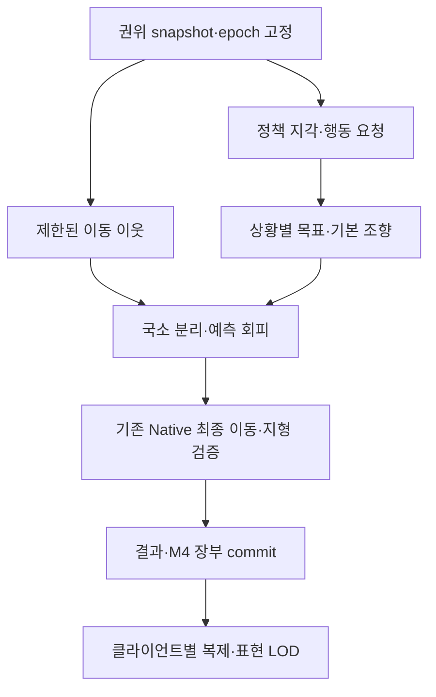

# Epic Mass 참고 생태계 이동 개선 — 개발 시작점

[09 지역 생태계 조향·회피 통합 계획과 개발 명세](09_AVOIDANCE_INTEGRATION_SPEC_20261112.md)는 사용자 피드백을 반영한 후속 구현 순서를 제공한다. 첫 묶음은 기존 계측으로 흔들림 원인을 확인하고, 정확 탐색·B/C1 실행 경계를 정리한 뒤 사슴 회피 shadow와 owned opt-in을 비교하는 것이다. 늑대 포획 관계·통로 양보·지역 경계·연결별 전송/표현 조건과 단계별 acceptance를 포함한다. 이번 후속은 문서 작성이며 새 구현·실행 검증 결과는 없다.

[08 에디터에서 이동 계측 확인](08_EDITOR_MOVEMENT_TRACE_QUICK_TEST.md)에서 첫 구현의 콘솔 명령과 평상시·도주 재현 절차를 확인한다.

다음 진단·이동 개선은 [06 Insights·Mass Debugger 실행/계측](06_INSIGHTS_MASS_DEBUGGER_20261112.md)과 [07 평상시 먹이 이동·긴급 도주 설계](07_GRAZE_FLIGHT_LOCOMOTION_20261112.md)를 따른다. 먼저 행동 전환과 같은 행동 안의 방향/보행 변화를 측정하고, 근거가 확보된 제어 또는 표시 개선을 구현한다. 두 문서는 설계이며 새 실행 검증 결과는 없다.

2026-11-12 후속: **[RL 판단 보존·여섯 비교 지점 통합 계획](RL_PRESERVING_EPIC_MASS_PLAN_20261112.md)**에서 실행 단위·스레드·주변 탐색·조향·갱신 주기·표현의 입출력, 변경 순서, 채택 기준을 읽는다. 이번 요청은 RL 판단/관측 주기를 유지한다. 아래 느린 응집·근사 관측 제안은 별도 실험 계약으로 남기며, 새 통합 계획의 A(정확 결과)/B(실행 동작)/C(범위 밖) 경계를 적용한다. 실제 소스·설치 UE5.8.3을 재확인한 문서 후속이며 새 코드·성능 실행 결과는 없다.

2026-11-10 / Source 기준 `jwj-1024 ef44df15`. **문서·제안 단계이며 런타임 구현, 기본값 변경, 신규 성능 검증은 없다.** 현재 변경은 작업 시작 시 실제 HEAD/diff와 다시 대조한다.

목표: 지역당 사슴1,024마리와 다지역에서 이동용 이웃 탐색·조향·실행·표현 비용을 관리하면서 기존 생태 폐루프를 보존한다. MassEntity는 이미 사용 중이다. Epic의 설계 원칙을 기존 Native backend에 적용하며 새 이동 backend로 일괄 교체하는 계획은 아니다.

## 기능별 문서

| 문서 | 구현 산출물 | 선행 조건 |
|---|---|---|
| [01 이웃 탐색·회피](01_NEIGHBOR_AVOIDANCE.md) | 제한된 후보 질의, 회피 실험, 현재 정확 경로 비교 | 기준선 계측 |
| [02 조향·이주 통합](02_STEERING_INTEGRATION.md) | 제어 단계와 우선순위 명시, 단일 이동 writer | 소비자 감사; 실제 동작 변경은 RL 계약 |
| [03 다지역 실행](03_REGION_EXECUTION.md) | snapshot 수명, 반복 구축 제거, 단계적 worker 분리 | GT 의존성 감사·결정성 검증 |
| [04 LOD·사건 처리](04_LOD_AND_SIGNALS.md) | 표현 예산, 느린 응집/즉시 사건 갱신 계약 | 기존 표현/복제·RL 소비 범위 감사 |
| [05 검증·채택](05_VALIDATION.md) | 비교 fixture, 비용/품질 리포트, opt-in·되돌리기 | 모든 기능 공통 |
| [09 조향·회피 통합](09_AVOIDANCE_INTEGRATION_SPEC_20261112.md) | 단계별 구현 계획, snapshot·제어 합성·포식 관계·통로·복제 계약 | 06~08 기준선과 기존 정확 탐색 P0/P1 |
| [참고자료](REFERENCES.md) | 공식 문서·원문 기술자료와 설치 엔진 확인 지점 | 사용자와 개발자 공통 |

## 현재와 목표 구조

현재: Mass Query → 지역별 Native View → GameThread Native Step(지각·정책·제어·이동·대사) → 기존 장부/표현. 동족 탐색은 정책 관측과 조향을 함께 생산한다. Native가 유일한 이동 writer이며 통합 Processor는 GameThread를 요구한다.

목표 구조(아직 미구현):

## 구현 순서와 기존 명세의 관계

이 묶음은 [기존 동족 탐색 명세](../BOUNDED_NEIGHBOR_SEARCH_SPEC_20261110.md)의 기능별 후속이다. 기존 P0 계측과 P1 정확 후보 순회 개선을 첫 작업으로 유지한다. 다음 순서로 진행한다.

1. 05의 기준선과 01/02의 소비자 감사를 수행한다. 원본 결과와 성능을 고정한다.
2. 기존 P1의 정렬/후보 재사용을 비교하고, 03의 반복 구축을 정확성이 유지되는 범위에서 줄인다.
3. 01의 제한 후보와 02의 조향 출력을 **shadow 모드**로 계산한다. shadow는 기존 출력만 실행하며 추가 계산 비용을 성능 개선으로 보고하지 않는다.
4. 제한 이웃/회피/응집 주기가 관측·행동에 미치는 내용을 RL 계약으로 확정한 뒤 실험 profile에서 활성화한다. 재학습 필요 여부는 RL 담당이 판정한다.
5. 03의 worker 실행과 04의 계산 주기 조절은 각각 독립 flag로 비교한다. 여러 변경을 한 번에 켜서 원인을 잃지 않는다.
6. 05의 통합 acceptance를 통과한 기능만 채택한다. 기본맵 전역 활성화는 별도 릴리스 결정이다.

## 공통 계약

- [공통 맥락](../../PROJECT_CONTEXT.md), [RL 담당 경계](../../RL_Policy/ECOSYSTEM_RL_AGENT_GUIDE_20261024.md), [Mass 순서](../../Mass/MASS_PROCESSOR_ORDER.md)를 따른다. 기존 R7e24/mask5, R1b, V1을 구분한다.
- Server/Standalone 권위, Native 단일 위치·대사·섭식 writer, 기존 M4 receipt/인구 집계, SocialControl 기본값과 맵 옵션을 보존한다. Epic 기본 Movement Processor를 같은 개체에 중복 적용하지 않는다.
- RL 관측·정규화·mask·행동·reward·가중치 변경을 이 문서가 자동 승인하지 않는다. 조향 변경도 Python 세계와의 의미 차이로 기록한다.
- 제안 API/설정 이름은 구현 시 기존 형식을 우선 재사용한다. 문서 속 이름을 이미 존재하는 콘솔 명령으로 안내하지 않는다.
- 새로운 영속 필드가 없으면 파생 캐시는 저장하지 않는다. 실행 의미에 영향을 주는 profile 설정은 checkpoint 호환성에 포함하고 현재 포맷을 임의로 과거 v2로 되돌리지 않는다.
- 원본 팀 맵·개인 발표 파일을 건드리지 않는다. C++ 변경 시 실행 중 엔진/UBT를 중단·중복 실행하지 않고 AGENTS의 직접 UBT 규칙을 따른다.

## 다음 채팅에 전달할 작업

> PROJECT_CONTEXT와 이 README, 01·02·05 및 06~09를 읽고 실제 HEAD/diff를 확인한다. 첫 작업은 기존 MoveTrace를 재사용한 흔들림 원인 판별과 지각·조향 소비자/GT 의존성 감사다. 09 단계 1~2에서 정확 후보 순회와 B/C1 경계 분리를 검증하고, 단계 3에서 사슴 회피 shadow를 준비한다. 이후 단계는 09의 완료 기준에 따라 진행한다. 실제 실행 결과와 남은 조건을 별도 기록에 남긴다.
